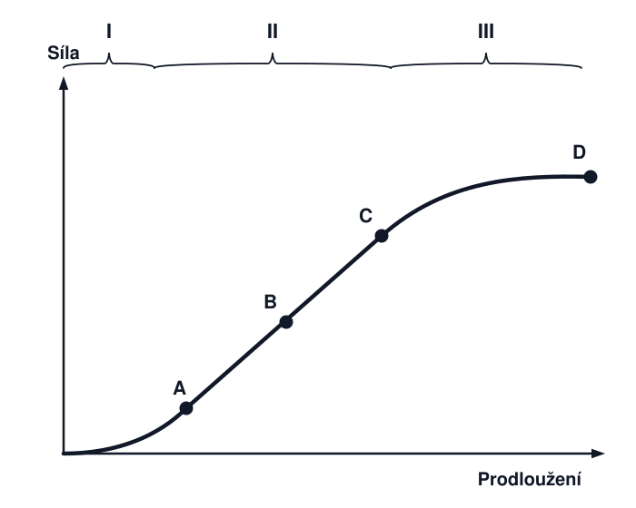
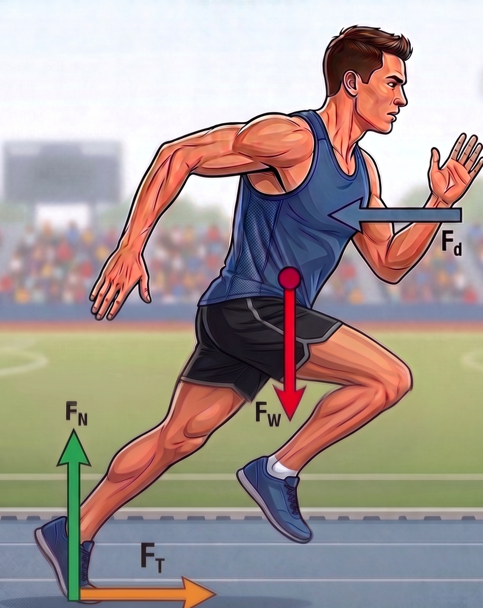
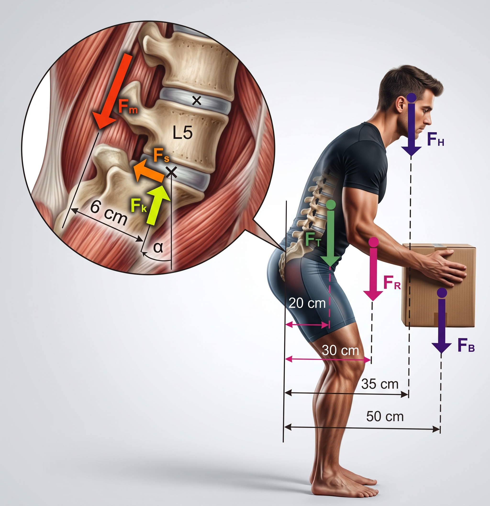
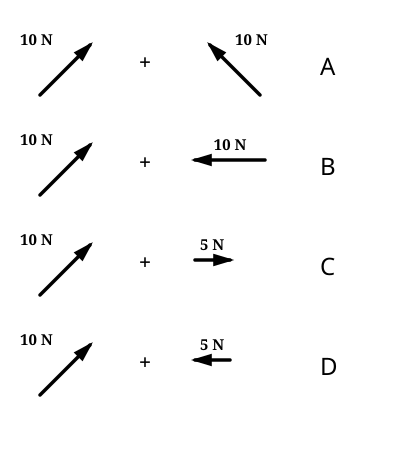
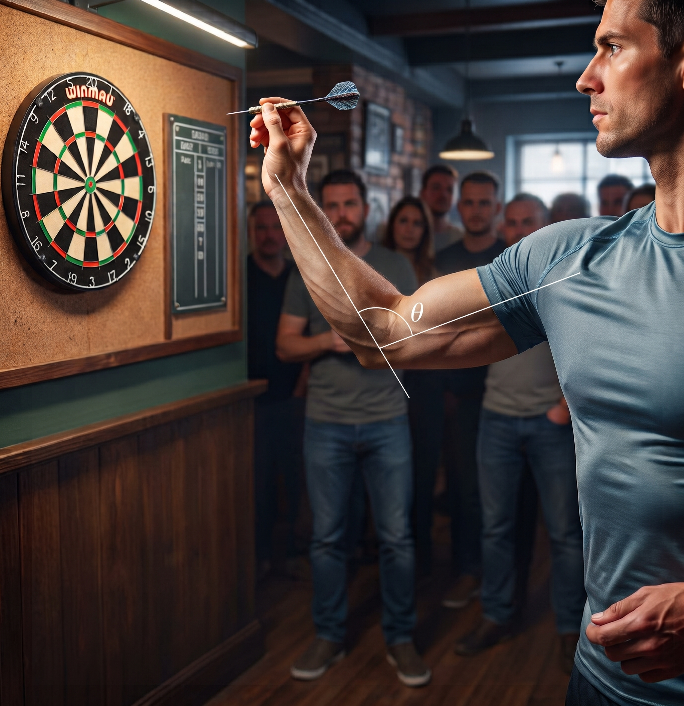
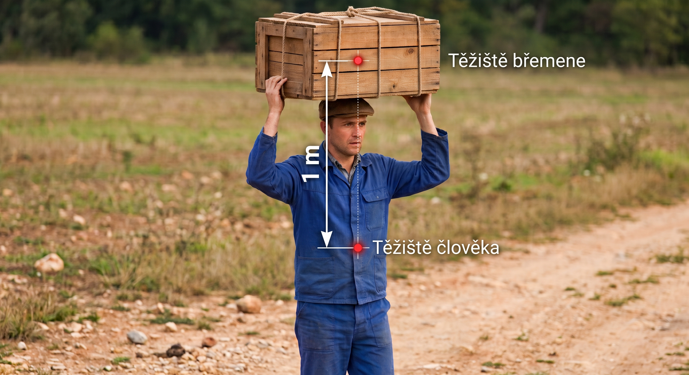
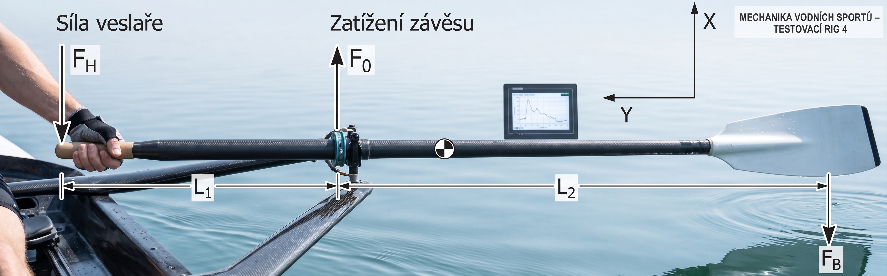
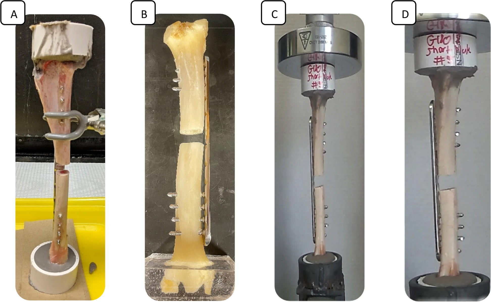
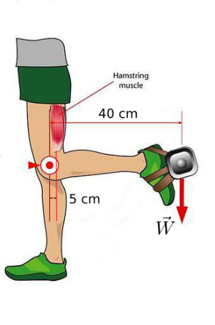

```markdown
# Příklady z biomechaniky

````{exercise} Odraz běžce
:label: ex-odraz-bezce

Běžec se odráží silou $F = 2000\text{ N}$ tak, že vektor síly svírá s horizontálou úhel $\alpha = 60^\circ$[cite: 1]. Určete složky vektoru odrazové síly v horizontálním a vertikálním směru[cite: 1].

```{figure} images/pr-001.png
:width: 250px
:align: center
:name: fig-odraz-bezce

Schéma rozkladu odrazové síly běžce.

```

````


````{solution} ex-odraz-bezce
:class: dropdown

Horizontální složka síly:
$$F_x = F \cdot \cos\alpha = 2000 \cdot \cos(60^\circ) = 2000 \cdot 0{,}5 = 1000\text{ N}$$

Vertikální složka síly:
$$F_y = F \cdot \sin\alpha = 2000 \cdot \sin(60^\circ) = 2000 \cdot \frac{\sqrt{3}}{2} \approx 1732{,}05\text{ N}$$

```

---

```{exercise} Veletoč na hrazdě
:label: ex-veletoc

Gymnasta provádí na hrazdě prvek, při kterém provede $2{,}5$ veletoče[cite: 1]. Určete velikost úhlu, který opíše jeho těžiště kolem hrazdy ve stupních a radiánech[cite: 1].

```{figure} images/pr-002.png
:width: 250px
:align: center
:name: fig-veletoc

Schéma fázového rozpadu veletoče na hrazdě. Převzato z [Burton a kol., 2023](https://doi.org/10.1080/02640414.2023.2259201).
```

````


```{solution} ex-veletoc
:class: dropdown

Jeden kompletní veletoč odpovídá úhlu $360^\circ$ neboli $2\pi\text{ rad}$.

Úhel ve stupních:
$$\Delta\theta = 2{,}5 \times 360^\circ = 900^\circ$$[cite: 1]

Úhel v radiánech:
$$\Delta\theta = 2{,}5 \times 2\pi = 5\pi\text{ rad} \approx 15{,}71\text{ rad}$$

```

---

```{exercise} Okamžitý modul pružnosti šlachy
:label: ex-modul-slachy

Tahový diagram šlachy je znázorněn na obrázku. Ve kterém bodě je maximální okamžitý modul pružnosti?

```{figure} images/pr-002.png
:width: 250px
:align: center
:name: fig-modul-slachy

Tahový diagram šlachy. Převzato z [DOI: 10.1088/0031-9120/36/1/302](https://doi.org/10.1088/0031-9120/36/1/302).
```

````


```{solution} ex-modul-slachy
:class: dropdown

Okamžitý modul pružnosti odpovídá směrnici tečny křivky napětí–deformace $E_{\text{tangent}} = \frac{\mathrm{d}\sigma}{\mathrm{d}\varepsilon}$. Maximální strmost vykazuje lineární úsek křivky před počátkem plastické deformace / mikroporušení (bod B).

```

---

````{exercise} Tření podrážky běžce
:label: ex-treni-podrazky

Koeficient statického tření mezi podrážkou boty běžce a zemí je $0{,}5$ a koeficient dynamického tření je $0{,}3$. Působí-li zem na běžce vertikální sílou $2000\text{ N}$, určete maximální horizontální sílu, kterou může běžec vyvinout bez podklouznutí nohy.

```{figure} images/pr-004.png
:width: 250px
:align: center
:name: fig-treni-podrazky

Působení reakčních sil na chodidlo.
```

````


```{solution} ex-treni-podrazky
:class: dropdown

Podmínka pro mezní stav bez podklouznutí je dána maximální statickou třecí silou:

$$F_{T,\max} = f_s \cdot F_N = 0{,}5 \cdot 2000\text{ N} = 1000\text{ N}$$

Rád vysvětlím směr jednotlivých sil zobrazených na obrázku. Z fyzikálního a biomechanického hlediska působí na běžce následujícím způsobem:

* **$F_W$ (Tíhová síla / Weight):** Směřuje svisle dolů. Zastupuje celkovou tíhu těla a působí v jeho těžišti (Center of Gravity). Je to síla, kterou je těleso přitahováno k Zemi.
* **$F_d$ (Odpor vzduchu / Drag force):** Směřuje vodorovně proti směru pohybu běžce. Představuje aerodynamický odpor, kterým okolní vzduch brání tělu v dopředném pohybu.
* **$F_N$ (Normálová síla / Normal force):** Směřuje svisle vzhůru z místa kontaktu chodidla s podložkou. Jedná se o kolmou reakci povrchu (Ground Reaction Force) na tlak, kterým noha působí na zem. Zabraňuje propadnutí běžce do dráhy.
* **$F_T$ (Třecí síla / Tractive, Friction force):** Směřuje vodorovně vpřed, tedy ve směru pohybu. V této fázi odrazu (push-off) funguje jako hnací síla. Když běžec působí nohou na dráhu silou směřující dozadu, dráha (díky statickému tření a 3. Newtonovu zákonu akce a reakce) působí na chodidlo stejně velkou silou směřující dopředu. Horizontální složka této reakce je právě $F_T$, která zajišťuje dopředný pohyb.

```

---

````{exercise} Zatížení meziobratlového disku
:label: ex-meziobratlovy-disk

Určete poměr $\frac{F_k}{F_s}$ velikostí kompresní síly $F_k$ a smykové síly $F_s$ působící v meziobratlovém disku, když víte, že velikost síly svalu *m. erector spinae* potřebná k udržení břemene $F_B = 100\text{ N}$ ve vodorovné poloze je $F_m = 1725\text{ N}$. Hmotnost hlavy je $m_H = 5{,}8\text{ kg}$, hmotnost trupu $m_T = 32{,}8\text{ kg}$ a hmotnost obou paží je $m_R = 8{,}1\text{ kg}$. Úhel $\alpha = 20^\circ$.

```{figure} images/pr-005.png
:width: 250px
:align: center
:name: fig-meziobratlovy-disk

Biomechanický model zatížení bederního segmentu.
```

````


```{solution} ex-meziobratlovy-disk
:class: dropdown

```

---

````{exercise} Skládání dvojice sil
:label: ex-skladani-dvojice-sil

Na těleso působí dvojice sil. Síly jsou vodorovně nebo pod úhlem $45^\circ$. Určete, ve kterém případě bude výslednice sil maximální.

```{figure} images/pr-006.png
:width: 250px
:align: center
:name: fig-skladani-dvojice-sil

Konfigurace vektorů sil.
```

````


```{solution} ex-skladani-dvojice-sil
:class: dropdown

Výslednice dvou vektorů $\mathbf{F}_1$ a $\mathbf{F}_2$ má velikost:
$$F_R = \sqrt{F_1^2 + F_2^2 + 2 F_1 F_2 \cos\theta}$$

Výslednice je maximální pro nejmenší vzájemný úhel $\theta$ mezi vektory (souhlasný směr působení).

```

---

````{exercise} Úhlový rozsah pohybu předloktí
:label: ex-predlokti-sipka

Průměrná úhlová rychlost předloktí při hodu šipkou je $\omega = \frac{\pi}{2}\text{ rad}\cdot\text{s}^{-1}$. Doba trvání pohybu je $t = 0{,}8\text{ s}$. Určete celkový rozsah pohybu předloktí při hodu ve stupních.

```{figure} images/pr-007.png
:width: 250px
:align: center
:name: fig-predlokti-sipka

Kinematika hodu šipkou.
```

````


```{solution} ex-predlokti-sipka
:class: dropdown

Úhlová dráha v radiánech:
$$\Delta\theta = \omega \cdot t = \frac{\pi}{2} \cdot 0{,}8 = 0{,}4\pi\text{ rad}$$

Převod na stupně:
$$\Delta\theta = 0{,}4\pi \cdot \frac{180^\circ}{\pi} = 72^\circ$$

```

---

````{exercise} Porušení kolagenních vláken šlachy
:label: ex-poruseni-vlaken

Tahový diagram šlachy je znázorněn na obrázku. Ve kterém úseku dochází k porušení kolagenních vláken?

```{figure} images/pr-008.png
:width: 250px
:align: center
:name: fig-poruseni-vlaken

Úseky deformační křivky šlachy.
```

````


```{solution} ex-poruseni-vlaken
:class: dropdown

K porušování a mikrotrhlinám kolagenních struktur dochází v post-elastické zóně / plastické oblasti (úsek III) před konečnou rupturou.

```

---

````{exercise} Těžiště člověka s břemenem
:label: ex-teziste-bremeno

Člověk o hmotnosti $m_1 = 70\text{ kg}$ nese na hlavě břemeno o hmotnosti $m_2 = 30\text{ kg}$. Vzdálenost těžiště těla a těžiště břemena je $d = 1\text{ m}$. V jaké vzdálenosti od těžiště těla se nachází společné těžiště soustavy?

```{figure} images/pr-009.png
:width: 250px
:align: center
:name: fig-teziste-bremeno

Schéma rozložení hmotností člověka a břemene.
```

````


```{solution} ex-teziste-bremeno
:class: dropdown

Zvolme počátek v těžišti těla ($x_1 = 0$, $x_2 = 1\text{ m}$):

$$x_T = \frac{m_1 x_1 + m_2 x_2}{m_1 + m_2} = \frac{70 \cdot 0 + 30 \cdot 1{,}0}{70 + 30} = \frac{30}{100} = 0{,}30\text{ m} = 30\text{ cm}$$


```

---

````{exercise} Rovnováha veslařského pádla
:label: ex-rovnovaha-padla

Síly, které působí na pádlo, jsou znázorněny na obrázku. Určete zatížení závěsu $F_0$, je-li síla vyvíjená veslařem $F_H = 100\text{ N}$, $L_1 = 30\text{ cm}$, $L_2 = 1\text{ m}$ a pádlo je v rovnováze.

```{figure} images/pr-010.png
:width: 250px
:align: center
:name: fig-rovnovaha-padla

Pákový mechanismus veslařského pádla.
```

````


```{solution} ex-rovnovaha-padla
:class: dropdown

```

---

````{exercise} Hmotnost dítěte na houpačce
:label: ex-dite-houpacka

Dítě je zavěšeno v houpačce podle obrázku. Určete hmotnost dítěte.

```{figure} images/pr-011.png
:width: 250px
:align: center
:name: fig-dite-houpacka

Statické silové schéma závěsu houpačky.
```

````


```{solution} ex-dite-houpacka
:class: dropdown

```

---

````{exercise} Utahovací moment matice
:label: ex-utahovani-matice

Při utahování matice působí síly podle obrázku. Určete výsledný moment sil působící na matici.

```{figure} images/pr-012.png
:width: 250px
:align: center
:name: fig-utahovani-matice

Utahování matice silovou dvojicí.
```

````


```{solution} ex-utahovani-matice
:class: dropdown

```

---

````{exercise} Deformace kosti v tahu
:label: ex-deformace-kosti

Kost kruhového průřezu o průměru $d = 5\text{ cm}$ je zatížena tahovou sílou o velikosti $F = 100\text{ N}$. Modul pružnosti kosti je $E = 10\text{ GPa} = 10 \cdot 10^9\text{ Pa}$. Určete velikost poměrného prodloužení $\varepsilon$.

```{figure} images/pr-013.png
:width: 250px
:align: center
:name: fig-deformace-kosti

Tahové zatížení vzorku kosti.
```

````


```{solution} ex-deformace-kosti
:class: dropdown

Plocha průřezu kosti:
$$S = \pi r^2 = \pi \left(\frac{0{,}05}{2}\right)^2 \approx 1{,}963 \cdot 10^{-3}\text{ m}^2$$

Normálové napětí:
$$\sigma = \frac{F}{S} = \frac{100}{1{,}963 \cdot 10^{-3}} \approx 50930\text{ Pa}$$

Poměrné prodloužení:
$$\varepsilon = \frac{\sigma}{E} = \frac{50930}{10 \cdot 10^9} \approx 5{,}09 \cdot 10^{-6} \approx 5 \cdot 10^{-6}$$

Co znamená plocha průřezu kosti v případě diafýzy dlouhé kosti?

```

---

````{exercise} Statické tření knihy a šálku
:label: ex-kniha-salek

Kniha o hmotnosti $m = 1\text{ kg}$ je spojena provázkem se zavěšeným šálkem. Určete tíhu šálku, je-li rychlost $v$ nulová a koeficient statického tření mezi knihou a podložkou je $f_s = 0{,}5$.

```{figure} images/pr-014.png
:width: 250px
:align: center
:name: fig-kniha-salek

Soustava těles spojených vláknem.
```

````


```{solution} ex-kniha-salek
:class: dropdown

```

---

````{exercise} Síla v hamstringách
:label: ex-sila-hamstringy

Určete sílu v ischiokrurálních svalech (hamstringy) $F_m$ při zatížení podle obrázku, je-li tíha břemene $W = 100\text{ N}$ a rozměry odpovídají schématu.

```{figure} images/pr-015.png
:width: 250px
:align: center
:name: fig-sila-hamstringy

Pákový model dolní končetiny a hamstringů.
```

````


```{solution} ex-sila-hamstringy
:class: dropdown

```

---

````{exercise} Kinematika běžeckého pásu
:label: ex-kinematika-pasu

Na obrázku je běžec na běžícím pásu, jehož pás se otáčí ve směru vyznačených šipek. Posuďte platnost tvrzení o působení třecích sil.

```{figure} images/pr-016.png
:width: 250px
:align: center
:name: fig-kinematika-pasu

Běžec na pohyblivém pásu trenažéru.
```

````


```{solution} ex-kinematika-pasu
:class: dropdown

Při odrazu chodidlo vůči povrchu pásu v ideálním případě neprokluzuje; v místě kontaktu působí síla statického tření, která přenáší odrazový impulz.

```

---

````{exercise} Izometrické škálování svalu
:label: ex-skalovani-svalu

Za předpokladu izometrického škálování určete, jak se změní maximální síla ve svalu $F_{\max}$, když se jeho charakteristická délka zvětší $3\times$.

```{figure} images/pr-017.png
:width: 250px
:align: center
:name: fig-skalovani-svalu

Geometrické škálování svalového těla.
```

````


```{solution} ex-skalovani-svalu
:class: dropdown

Maximální svalová síla je přímo úměrná fyziologickému průřezu svalu ($\text{PCSA} \propto L^2$):

$$\frac{F_2}{F_1} = \left(\frac{L_2}{L_1}\right)^2 = 3^2 = 9$$

Maximální síla ve svalu vzroste $9\times$.

```

---

````{exercise} Poloha těžiště horní končetiny
:label: ex-poloha-teziste-paze

Určete horizontální polohu těžiště horní končetiny s činkou, je-li $L = 35\text{ cm}$ a $\alpha = 30^\circ$. Hmotnost segmentu $OB$ je $3\text{ kg}$, segmentu $BC$ je $2\text{ kg}$ a hmotnost činky v bodě $C$ je $5\text{ kg}$. Těžiště segmentů leží v jejich polovině.

```{figure} images/pr-018.png
:width: 250px
:align: center
:name: fig-poloha-teziste-paze

Segmentální geometrie paže při flexi.
```

````


```{solution} ex-poloha-teziste-paze
:class: dropdown

```

---

````{exercise} Výška výskoku ze silové desky
:label: ex-vyska-vyskoku-deska

Na obrázku je znázorněn záznam reakční síly na silovou desku při vertikálním skoku z místa. Určete výšku výskoku skokana na základě naměřené doby letové fáze $t_{\text{flight}}$.

```{figure} images/pr-019.png
:width: 250px
:align: center
:name: fig-vyska-vyskoku-deska

Záznam vertikální složky síly GRF v čase.
```

````


```{solution} ex-vyska-vyskoku-deska
:class: dropdown

Z doby letu ve vzduchu $t_{\text{flight}}$:
$$h = \frac{1}{8} g \cdot t_{\text{flight}}^2 = \frac{g \cdot t_{\text{flight}}^2}{8}$$

```

---

````{exercise} Tuhost běžecké protézy
:label: ex-tuhost-protezy

Běžec o hmotnosti $m = 65\text{ kg}$ s transtibiální protézou vyvolá sílu na podložku o velikosti $F = 500\text{ N}$. Pružný segment protézy se při tomto zatížení deformuje o $\Delta x = 2{,}5\text{ cm} = 0{,}025\text{ m}$. Jaká je tuhost protézy $k$?

```{figure} images/pr-020.png
:width: 250px
:align: center
:name: fig-tuhost-protezy

Běžecká čepelová protéza dolní končetiny.
```

````


```{solution} ex-tuhost-protezy
:class: dropdown

Podle Hookeova zákona:
$$k = \frac{F}{\Delta x} = \frac{500\text{ N}}{0{,}025\text{ m}} = 20000\text{ N/m} = 20\text{ kN/m}$$

```

---

````{exercise} Statická rovnováha bérce a chodidla
:label: ex-statika-berce

Na obrázku je znázorněn systém bérce a chodidla při chůzi. Síla $J$ a moment $M$ se přenášejí na kolenní kloub $K$. Hmotnost holeně je $3{,}75\text{ kg}$ ($S$ v bodě $A$), hmotnost chodidla je $0{,}75\text{ kg}$ ($F$ v bodě $B$). Výsledná reakční síla $R$ působí v bodě $H$ pod úhlem $\alpha$. Vypočítejte velikost reakční síly $R$.

```{figure} images/pr-021.png
:width: 250px
:align: center
:name: fig-statika-berce

Silový rozbor segmentů bérce a nohy.
```

````


```{solution} ex-statika-berce
:class: dropdown

```

---

````{exercise} Pohyb na skluzavce
:label: ex-pohyb-skluzavka

Dítě o hmotnosti $m = 55{,}9\text{ kg}$ sjíždí po skluzavce s počáteční rychlostí $v_0 = 1\text{ m/s}$ na vrcholu. V dolní části skluzavky opouští dráhu vodorovně rychlostí $v_1 = 5\text{ m/s}$ a dopadne do vody ve vzdálenosti $d = 2\text{ m}$ od paty skluzavky. Určete výšku skluzavky $h$.

```{figure} images/pr-022.png
:width: 250px
:align: center
:name: fig-pohyb-skluzavka

Profil skluzavky a trajektorie vodorovného vrhu.
```

````


```{solution} ex-pohyb-skluzavka
:class: dropdown

```

---

````{exercise} Svalová síla hlubokého ohybače prstů
:label: ex-hluboky-ohybac

Na špičku ukazováčku působí vnější síla $F = 20\text{ N}$ pod úhlem $40^\circ$ k vodorovné rovině. Síla flexoru působí v kolmé vzdálenosti $d = 0{,}5\text{ cm}$ od DIP kloubu $J$. Horizontální a vertikální vzdálenost působiště vnější síly od kloubu je $1{,}5\text{ cm}$ a $0{,}6\text{ cm}$. Vypočítejte tahovou sílu flexoru.

```{figure} images/pr-023.png
:width: 250px
:align: center
:name: fig-hluboky-ohybac

Pákový model distálního interfalangeálního kloubu (DIP).
```

````


```{solution} ex-hluboky-ohybac
:class: dropdown

```

---

````{exercise} Svalová síla při běhu na lyžích
:label: ex-lyzovani-koleno

Běžec na lyžích se nachází v cílové rovince. Určete svalovou sílu $F_{\text{sme}}$, je-li horizontální vzdálenost mezi středem kolenního kloubu a působištěm síly rovna $d = 6\text{ cm}$.

```{figure} images/pr-024.png
:width: 250px
:align: center
:name: fig-lyzovani-koleno

Kinematické a silové schéma dolní končetiny při lyžování.
```

````


```{solution} ex-lyzovani-koleno
:class: dropdown

```

---

````{exercise} Náraz vozidla do dodávky
:label: ex-kolize-automobilu

Na obrázku je zobrazeno auto a dodávka těsně před a těsně po srážce. Dodávka je zpočátku v klidu. Určete rychlost dodávky po srážce na základě zákona zachování hybnosti.

```{figure} images/pr-025.png
:width: 250px
:align: center
:name: fig-kolize-automobilu

Ráz dvou těles.
```

````


```{solution} ex-kolize-automobilu
:class: dropdown

Ze zákona zachování hybnosti pro dokonale pružný / nepružný ráz dle zadaných koeficientů:
$$m_1 v_{1i} + m_2 v_{2i} = m_1 v_{1f} + m_2 v_{2f}$$

```

---

````{exercise} Svalová síla erektorů páteře
:label: ex-erector-spinae-momenty

Určete tahovou sílu svalů *m. erector spinae* při předklonu, kde $a$ je rameno svalu, $b$ je rameno tíhy břemene $W_1$ a $c$ je rameno tíhy části těla nad uvažovaným segmentem páteře.

```{figure} images/pr-026.png
:width: 250px
:align: center
:name: fig-erector-spinae-momenty

Pákový model lumbosakrálního přechodu.
```

````


```{solution} ex-erector-spinae-momenty
:class: dropdown

Z momentové podmínky rovnováhy k rotačnímu středu disku $\sum M = 0$:

$$F_m \cdot a - W_1 \cdot b - W_{\text{body}} \cdot c = 0 \implies F_m = \frac{W_1 \cdot b + W_{\text{body}} \cdot c}{a}$$

```

---

````{exercise} Síla působící na čéšku
:label: ex-sila-patela-symetricka

Šlacha čtyřhlavého svalu stehenního a šlacha čéšky táhnou čéšku tahovými silami $T_1 = T_2 = 2000\text{ N}$. Vypočítejte velikost výsledné kompresní síly působící na čéšku.

```{figure} images/pr-027.png
:width: 250px
:align: center
:name: fig-sila-patela-symetricka

Skládání tahových sil působících na patelu.
```

````


```{solution} ex-sila-patela-symetricka
:class: dropdown

Výslednice dvou shodně velkých sil svírajících úhel $\theta$:
$$R = 2 T \cdot \cos\left(\frac{\theta}{2}\right)$$

```

---

````{exercise} Volba souřadnic pro mocninné závislosti
:label: ex-souradnice-skalovani

Jaký typ souřadnicové transformace (měřítka os) je nutné využít pro grafické znázornění alometrické mocninné závislosti $y = a \cdot x^b$, aby byl výsledný graf přímkový?

```{figure} images/pr-028.png
:width: 250px
:align: center
:name: fig-souradnice-skalovani

Logaritmická transformace os.
```

````


```{solution} ex-souradnice-skalovani
:class: dropdown

Používají se **oboustranně logaritmické souřadnice** ($\log\text{--}\log$).

Logaritmováním vztahu $y = a \cdot x^b$ získáme lineární rovnici:
$$\log y = \log a + b \log x$$
kde směrnice přímky odpovídá exponentu škálování $b$.

```

---

````{exercise} Mechanický výkon při běhu do schodů
:label: ex-vykon-schody

Jaký je celkový mechanický výkon ženy o hmotnosti $m = 60{,}0\text{ kg}$, která vyběhne schodiště o výšce $h = 3{,}00\text{ m}$ za čas $t = 3{,}50\text{ s}$, přičemž začíná z klidu a v cíli má rychlost $v = 2{,}00\text{ m/s}$?

```{figure} images/pr-029.png
:width: 250px
:align: center
:name: fig-vykon-schody

Běh do schodů – změna potenciální a kinetické energie.
```

````


```{solution} ex-vykon-schody
:class: dropdown

Celková vykonaná mechanická práce:
$$W = \Delta E_p + \Delta E_k = mgh + \frac{1}{2}mv^2$$
$$W = 60 \cdot 9{,}81 \cdot 3 + \frac{1}{2} \cdot 60 \cdot 2^2 = 1765{,}8 + 120 = 1885{,}8\text{ J}$$

Průměrný mechanický výkon:
$$P = \frac{W}{t} = \frac{1885{,}8}{3{,}50} \approx 538{,}8\text{ W}$$

```

---

````{exercise} Svalová síla při předklonu hlavy
:label: ex-predklon-hlavy-rovnovaha

Při předklonu hlavy působí síly podle obrázku. Určete svalovou sílu šíjového svalstva $F_m$, je-li hmotnost hlavy $m = 5\text{ kg}$ ($G \approx 50\text{ N}$), rameno tíhy $d_W = 6\text{ cm}$ a rameno svalové síly $d_F = 2\text{ cm}$.

```{figure} images/pr-030.png
:width: 250px
:align: center
:name: fig-predklon-hlavy-rovnovaha

Pákový model atlantookcipitálního skloubení.
```

````


```{solution} ex-predklon-hlavy-rovnovaha
:class: dropdown

Z momentové podmínky rovnováhy k ose kloubu:
$$F_m \cdot d_F = G \cdot d_W \implies F_m = G \cdot \frac{d_W}{d_F} = (5 \cdot 9{,}81) \cdot \frac{6}{2} \approx 49{,}05 \cdot 3 = 147{,}15\text{ N}$$

```

````


```


# Sbírka příkladů z biomechaniky

---


### Příklad 2
Gymnasta provádí na hrazdě prvek, při kterém provede $2{,}5$ veletoče. Velikost úhlu, který opíše jeho těžiště kolem hrazdy, je:
- a) $180^\circ$
- b) $360^\circ$
- c) $540^\circ$
- d) $900^\circ$



---

### Příklad 3
Tahový diagram šlachy je znázorněn na obrázku. Ve kterém bodě je maximální okamžitý modul pružnosti?
- a) $\text{A}$
- b) $\text{B}$
- c) $\text{C}$
- d) $\text{D}$


---

### Příklad 4
Koeficient statického tření mezi podrážkou boty běžce a zemí je $f_s = 0{,}5$ a koeficient dynamického tření je $f_d = 0{,}3$. Působí-li zem na běžce vertikální sílou $2000\text{ N}$ (ground reaction force), určete maximální horizontální sílu, kterou může běžec vyvinout bez podklouznutí nohy.
- a) $300\text{ N}$
- b) $600\text{ N}$
- c) $1000\text{ N}$
- d) $2000\text{ N}$



---

### Příklad 5
Určete poměr $\frac{F_k}{F_s}$ velikostí kompresní síly $F_k$ a smykové síly $F_s$ působící v meziobratlovém disku, když víte, že velikost síly svalu *m. erector spinae* potřebná k udržení břemene $F_B = 100\text{ N}$ ve vodorovné poloze je $F_m = 1725\text{ N}$. Hmotnost hlavy $m_H = 5{,}8\text{ kg}$, hmotnost trupu $m_T = 32{,}8\text{ kg}$ a hmotnost obou paží je $m_R = 8{,}1\text{ kg}$. Úhel $\alpha = 20^\circ$.
- a) $5{,}2$
- b) $13{,}6$
- c) $36{,}3$
- d) $124{,}4$



---

### Příklad 6
Na těleso působí dvojice sil. Síly působí vodorovně nebo pod úhlem $45^\circ$. Určete, ve kterém případě bude výslednice sil maximální.
- a) $\text{A}$
- b) $\text{B}$
- c) $\text{C}$
- d) $\text{D}$



---

### Příklad 7
Průměrná úhlová rychlost předloktí při hodu šipkou je $\omega = \frac{\pi}{2}\text{ s}^{-1}$. Doba trvání pohybu je $t = 0{,}8\text{ s}$. Celkový rozsah pohybu předloktí při hodu je:
- a) $72^\circ$
- b) $95^\circ$
- c) $144^\circ$
- d) $1{,}256^\circ$



---

### Příklad 8
Tahový diagram šlachy je znázorněn na obrázku. Ve kterém úseku dochází k porušení kolagenních vláken?
- a) $\text{I}$
- b) $\text{II}$
- c) $\text{III}$
- d) k porušení nedochází


---

### Příklad 9
Člověk o hmotnosti $70\text{ kg}$ nese na hlavě břemeno o hmotnosti $30\text{ kg}$. Vzdálenost těžiště těla a těžiště břemena je $1\text{ m}$. Těžiště soustavy člověk s břemenem se nachází od těžiště těla ve vzdálenosti:
- a) $3\text{ cm}$
- b) $7\text{ cm}$
- c) $25\text{ cm}$
- d) $30\text{ cm}$



---

### Příklad 10
Síly působící na pádlo jsou znázorněny na obrázku. Určete zatížení závěsu $F_0$, je-li síla vyvíjená veslařem $F_H = 100\text{ N}$, $L_1 = 30\text{ cm}$, $L_2 = 1\text{ m}$ a pádlo je v rovnováze.
- a) $30\text{ N}$
- b) $130\text{ N}$
- c) $333\text{ N}$
- d) $433\text{ N}$



---

### Příklad 11
Dítě je zavěšeno v houpačce podle obrázku. Určete hmotnost dítěte.
- a) $3{,}9\text{ kg}$
- b) $6{,}5\text{ kg}$
- c) $7{,}8\text{ kg}$
- d) $11{,}2\text{ kg}$


---

### Příklad 12
Při utahování matice působí síly podle obrázku. Výsledný moment sil působící na matici je:
- a) $27\text{ N}\cdot\text{m}$
- b) $28\text{ N}\cdot\text{m}$
- c) $2700\text{ N}\cdot\text{m}$
- d) $2800\text{ N}\cdot\text{m}$


---

### Příklad 13
Kost kruhového průřezu o průměru $d = 5\text{ cm}$ je zatížena tahovou sílou o velikosti $F = 100\text{ N}$. Modul pružnosti kosti je $E = 10\text{ GPa}$. Určete velikost poměrného prodloužení $\varepsilon$.
- a) $5 \cdot 10^{-6}$
- b) $20 \cdot 10^{-6}$
- c) $5 \cdot 10^{-6}\text{ m}$
- d) $20 \cdot 10^{-6}\text{ m}$



---

### Příklad 14
Kniha o hmotnosti $m = 1\text{ kg}$ je připevněna k šálku. Určete tíhu šálku, je-li rychlost $v$ nulová a koeficient statického tření mezi knihou a podložkou je $f = 0{,}5$.
- a) $0{,}84\text{ N}$
- b) $1{,}27\text{ N}$
- c) $2{,}35\text{ N}$
- d) $10{,}3\text{ N}$


---

### Příklad 15
Určete sílu v ischiokrurálních svalech (hamstringy) $F_m$ při zatížení podle obrázku, je-li síla $W = 100\text{ N}$ a geometrické rozměry odpovídají schématu.
- a) $50\text{ N}$
- b) $100\text{ N}$
- c) $800\text{ N}$
- d) $4000\text{ N}$



---

### Příklad 16
V grafu je znázorněna závislost rychlosti $v$ na čase $t$. Ve kterém úseku je zrychlení nejvyšší?
- a) $0\text{--}10\text{ min}$
- b) $10\text{--}15\text{ min}$
- c) $15\text{--}40\text{ min}$
- d) $40\text{--}55\text{ min}$


---

### Příklad 17
Hráč drží v ruce pálku o tíze $G = 10\text{ N}$. Těžiště pálky se nachází ve vzdálenosti $r = 60\text{ cm}$ od bodu $\text{O}$. Určete celkový moment síly, kterým působí hráč na pálku, je-li pálka v rovnováze.
- a) $0{,}6\text{ N}\cdot\text{m}$
- b) $3\text{ N}\cdot\text{m}$
- c) $6\text{ N}\cdot\text{m}$
- d) $60\text{ N}\cdot\text{m}$


---

### Příklad 18
Ocelový drát má délku $L = 1{,}12\text{ m}$ a plochu průřezu $S = 6{,}0 \cdot 10^{-3}\text{ cm}^2$. Youngův modul pružnosti je $E = 20 \cdot 10^{10}\text{ N/m}^2$. Pod tahem $F = 115\text{ N}$ je prodloužení drátu $\Delta L$:
- a) $0{,}1\text{ mm}$
- b) $1\text{ mm}$
- c) $1 \cdot 10^{-7}\text{ m}$
- d) $100\text{ mm}$


---

### Příklad 19
Na obrázku je pravítko vyrobené z homogenního materiálu. Určete horizontální pozici těžiště od levého dolního rohu pravítka.
- a) $2{,}3\text{ cm}$
- b) $3{,}8\text{ cm}$
- c) $4{,}7\text{ cm}$
- d) $6{,}2\text{ cm}$


---

### Příklad 20
Člověk v předklonu zvedá břemeno o tíze $G_b = 200\text{ N}$. Záda jsou ve vodorovné poloze. Předpokládejme, že *musculus erector spinae* se upíná ve $\frac{2}{3}$ délky páteře a svírá s ní úhel $12^\circ$. Tíha horní části těla je $G_t = 350\text{ N}$ a její těžiště je v polovině délky páteře. Určete sílu v *musculus erector spinae*.
- a) $375\text{ N}$
- b) $550\text{ N}$
- c) $2700\text{ N}$
- d) $3100\text{ N}$


---

### Příklad 21
Při trakci působí na femur síly podle obrázku. Velikost $x$-ové složky výslednice sil je:
- a) $23{,}9\text{ N}$
- b) $14{,}9\text{ N}$
- c) $8{,}4\text{ N}$
- d) $4{,}9\text{ N}$


---

### Příklad 22
Na těleso působí síly podle obrázku. Velikost síly $F_1$ je:
- a) $4400\text{ N}$
- b) $4500\text{ N}$
- c) $4600\text{ N}$
- d) $4700\text{ N}$


---

### Příklad 23
Běžec běží volně rychlostí $v_1 = 10\text{ m/s}$. Při sprintu se jeho kinetická energie zvýší dvojnásobně ($E_{k2} = 2 E_{k1}$). Jeho rychlost při sprintu je:
- a) $12\text{ m/s}$
- b) $14\text{ m/s}$
- c) $20\text{ m/s}$
- d) $40\text{ m/s}$


---

### Příklad 24
Síla o velikosti $F = 25\text{ N}$ urychluje po vodorovné rovině těleso o hmotnosti $m = 9{,}0\text{ kg}$ se zrychlením $a = 1{,}5\text{ m}\cdot\text{s}^{-2}$. Určete koeficient dynamického tření $f_d$.
- a) $0{,}05$
- b) $0{,}13$
- c) $0{,}22$
- d) $0{,}55$


---

### Příklad 25
Člověk působí horizontální sílou $F = 192\text{ N}$ na zařízení podle obrázku ($L = 0{,}31\text{ m}$, $h = 0{,}047\text{ m}$). Síla v bicepsu je:
- a) $29\text{ N}$
- b) $845\text{ N}$
- c) $1266\text{ N}$
- d) $2532\text{ N}$


---

### Příklad 26
Na hlavici femuru působí síla $F = 2\text{ kN}$ pod úhlem $60^\circ$ k podélné ose krčku femuru. Moment síly ve vzdálenosti $3\text{ cm}$ od působiště síly je:
- a) $30\text{ N}\cdot\text{m}$
- b) $52\text{ N}\cdot\text{m}$
- c) $3000\text{ N}\cdot\text{m}$
- d) $5196\text{ N}\cdot\text{m}$


---

### Příklad 27
V ortodoncii se používá předepjatý drát pro korekci chrupu. Působí-li na zub stejně velké síly $T = 30\text{ N}$ podle obrázku, výsledná síla působící na zub je:
- a) $8{,}3\text{ N}$
- b) $16{,}5\text{ N}$
- c) $28{,}8\text{ N}$
- d) $57{,}6\text{ N}$


---

### Příklad 28
Na obrázku je znázorněna závislost dráhy na čase při volném pádu. Hmotnost padajícího objektu je:
- a) $1\text{ kg}$
- b) $5\text{ kg}$
- c) $7\text{ kg}$
- d) nelze určit


---

### Příklad 29
Ve které pozici má lidské tělo minimální moment setrvačnosti vzhledem k vyznačené ose rotace?


---

### Příklad 30
Určete sílu v *musculus deltoideus*. Hmotnost volné horní končetiny je $m = 3{,}6\text{ kg}$, těžiště je ve vzdálenosti $L_1 = 0{,}66\text{ m}$, úpon svalu je ve vzdálenosti $L_2 = 0{,}33\text{ m}$ od ramenního kloubu. Úhel tahu svalu vzhledem k humeru je $20^\circ$. Předpokládejte, že humerus je ve vodorovné poloze.
- a) $36\text{ N}$
- b) $76\text{ N}$
- c) $210\text{ N}$
- d) $253\text{ N}$


---

### Příklad 31
Velikost vektoru $\mathbf{u}$ je:
- a) $10\text{ cm}$
- b) $30\text{ cm}$
- c) $90\text{ cm}$
- d) $200\text{ cm}$


---

### Příklad 32
Při přetahování lanem vyvinula tři družstva následující síly:
* Družstvo 1: horizontální složka $F_{1x} = 1250\text{ N}$, vertikální složka $F_{1y} = 139\text{ N}$
* Družstvo 2: horizontální složka $F_{2x} = 790\text{ N}$, vertikální složka $F_{2y} = -139\text{ N}$

Aby byla celá soustava v rovnováze, musí pro složky síly třetího družstva platit:
- a) $F_{3x} = 2040\text{ N}$, $F_{3y}$ je libovolná
- b) $F_{3x} = -2040\text{ N}$, $F_{3y}$ je libovolná
- c) $F_{3x} = 2040\text{ N}$, $F_{3y} = 0\text{ N}$
- d) $F_{3x} = -2040\text{ N}$, $F_{3y} = 0\text{ N}$


---

### Příklad 33
Rotační složka šlachové síly je vyjádřena vektorem:
- a) $\mathbf{c}$
- b) $\mathbf{d}$
- c) $\mathbf{e}$
- d) $\mathbf{f}$


---

### Příklad 34
Běžec provede 5 dvojkroků za $t = 3\text{ s}$ průměrnou rychlostí $v = 6\text{ m}\cdot\text{s}^{-1}$. Průměrná délka jednoho dvojkroku je:
- a) $3\text{ m}$
- b) $3{,}6\text{ m}$
- c) $4{,}5\text{ m}$
- d) $5\text{ m}$


---

### Příklad 35
Cyklista jede na kole tak, že jeho stehno rotuje úhlovou rychlostí $\omega = 60^\circ\cdot\text{s}^{-1}$ (extenze kyčle) a úhlové zrychlení do flexe kolene je $\alpha = 5^\circ\cdot\text{s}^{-2}$. Obvodová rychlost kolena je:
- a) $0{,}367\text{ m}\cdot\text{s}^{-1}$
- b) $2{,}11\text{ m}\cdot\text{s}^{-1}$
- c) $21\text{ m}\cdot\text{s}^{-1}$
- d) $175\text{ m}\cdot\text{s}^{-1}$


---

### Příklad 36
Velikost složek síly $F = 200\text{ N}$ ve směru os $x$ a $y$, kterou působí fyzioterapeut na končetinu pacienta, je:
- a) $197\text{ N}$; $34{,}7\text{ N}$
- b) $34{,}7\text{ N}$; $197\text{ N}$
- c) $134{,}7\text{ N}$; $97\text{ N}$
- d) $97\text{ N}$; $134{,}7\text{ N}$


---

### Příklad 37
V bodě grafu vyjadřujícího závislost rychlosti na čase, ve kterém je hodnota rychlosti maximální (tečna je rovnoběžná s časovou osou), je velikost okamžitého zrychlení:
- a) $0$
- b) kladné číslo
- c) záporné číslo
- d) nelze obecně určit


---

### Příklad 38
Disk se při otočce pohybuje rovnoměrně po kružnici o poloměru $r = 1\text{ m}$. Jestliže velikost jeho normálového zrychlení je $a_n = 11\text{ m}\cdot\text{s}^{-2}$, potom velikost tečného zrychlení $a_t$ je:
- a) $11\text{ m}\cdot\text{s}^{-2}$
- b) $10\text{ m}\cdot\text{s}^{-2}$
- c) $1\text{ m}\cdot\text{s}^{-2}$
- d) $0\text{ m}\cdot\text{s}^{-2}$


---

### Příklad 39
Výsledný moment setrvačnosti dvou cvičenců o hmotnostech $m_1$ a $m_2$, kteří provádějí veletoč na hrazdě, je:
- a) $J = J_{01} + m_1 r_1^2 + J_{02} + m_2 r_2^2$
- b) $J = J_{01} + m_1 r_1 + J_{02} + m_2 r_2$
- c) $J = (m_1 + m_2)(r_1 + r_2)^2$
- d) $J = (m_1 + m_2)(r_1 + r_2)$


---

### Příklad 40
Jak velký je rozdíl ve velikosti reakční síly $R$ u lidí stojících na jedné noze, když první člověk váží $85\text{ kg}$ a druhý váží $60\text{ kg}$? Hmotnost trupu představuje $\frac{2}{3}$ celkové hmotnosti a hmotnost dolní končetiny je $\frac{1}{6}$ celkové hmotnosti.
- a) rozdíl je $425\text{ N}$
- b) rozdíl je $624\text{ N}$
- c) rozdíl je $1247\text{ N}$
- d) rozdíl je $1935\text{ N}$


---

### Příklad 41
Velikost úhlu $\alpha$ je:
- a) $30^\circ$
- b) $45^\circ$
- c) $60^\circ$
- d) $75^\circ$


---

### Příklad 42
Skokan do vody má v dané fázi skoku moment setrvačnosti $J_1 = 4\text{ kg}\cdot\text{m}^2$ a rotuje úhlovou rychlostí $\omega_1 = 6\text{ rad}\cdot\text{s}^{-1}$. Těsně před dopadem do vody je jeho moment setrvačnosti $J_2 = 15\text{ kg}\cdot\text{m}^2$. Úhlová rychlost rotace $\omega_2$ v tomto okamžiku je:
- a) $1{,}6\text{ rad}\cdot\text{s}^{-1}$
- b) $3\text{ rad}\cdot\text{s}^{-1}$
- c) $6\text{ rad}\cdot\text{s}^{-1}$
- d) $15\text{ rad}\cdot\text{s}^{-1}$


---

### Příklad 43
Rozdílem vektorů $\mathbf{a} - \mathbf{b}$ je vektor:
- a) $\mathbf{c}$
- b) $\mathbf{d}$
- c) $\mathbf{e}$
- d) $\mathbf{f}$


---

### Příklad 44
O jak velkou hodnotu se sníží síla $F$ vyvíjená člověkem změnou konstrukce kolečka, je-li hmotnost kolečka $m = 10\text{ kg}$ a tíha nákladu $L = 500\text{ N}$?
- a) $35\text{ N}$
- b) $46\text{ N}$
- c) $154\text{ N}$
- d) $200\text{ N}$


---

### Příklad 45
Určete velikost síly svalu *m. biceps brachii* $F_m$, která udrží paži se závažím o tíze $F = 100\text{ N}$ ve vodorovné poloze.
- a) $F_m = 421\text{ N}$
- b) $F_m = 714\text{ N}$
- c) $F_m = 1064\text{ N}$
- d) $F_m = 1560\text{ N}$


---

### Příklad 46
Kluk působí na míč sílou $F = 100\text{ N}$. Délka lana je $L = 1{,}5\text{ m}$ a úhel lana je $\theta = 30^\circ$. Určete moment, kterým působí síla vzhledem k ose otáčení.
- a) $75\text{ N}\cdot\text{m}$
- b) $100\text{ N}\cdot\text{m}$
- c) $130\text{ N}\cdot\text{m}$
- d) $150\text{ N}\cdot\text{m}$


---

### Příklad 47
Pes o hmotnosti $m = 2\text{ kg}$ běží rychlostí $v = 6\text{ m/s}$. Určete jeho kinetickou energii $E_k$.
- a) $12\text{ J}$
- b) $24\text{ J}$
- c) $36\text{ J}$
- d) $48\text{ J}$


---

### Příklad 48
Na obrázku je záznam tahové zkoušky nové slitiny pro biomedicínské aplikace. Určete Youngův modul pružnosti $E$.
- a) $0{,}1\text{ MPa}$
- b) $0{,}2\text{ MPa}$
- c) $0{,}05\text{ MPa}$
- d) $1\text{ MPa}$


---

### Příklad 49
V jaké výšce od podlahy se nachází těžiště člověka o hmotnosti $80\text{ kg}$ na invalidním vozíku o hmotnosti $20\text{ kg}$, jestliže se těžiště prázdného vozíku nachází ve výšce $50\text{ cm}$ a těžiště obsazeného vozíku se nachází ve výšce $100\text{ cm}$?
- a) $105{,}5\text{ cm}$
- b) $112{,}5\text{ cm}$
- c) $134{,}5\text{ cm}$
- d) $150\text{ cm}$


---

### Příklad 50
Seřaďte síly podle velikosti:
- a) $F_A > F_P > N$
- b) $F_P > F_A > N$
- c) $N > F_A > F_P$
- d) $F_P > N > F_A$


---

### Příklad 51
Síly ve svalu působí podle obrázku. Jak velká je výsledná síla?
- a) $68{,}4\text{ N}$
- b) $187{,}9\text{ N}$
- c) $136{,}8\text{ N}$
- d) $375{,}8\text{ N}$


---

### Příklad 52
Na těleso o hmotnosti $m = 1\text{ kg}$ začne v čase $t = 0\text{ s}$ působit stálá síla o velikosti $F = 5\text{ N}$. Jaká bude rychlost tělesa v čase $t = 2\text{ s}$?
- a) $5\text{ m/s}$
- b) $10\text{ m/s}$
- c) $15\text{ m/s}$
- d) $20\text{ m/s}$


---

### Příklad 53
Na obrázku je závislost síly na deformaci (prodloužení) pro biceps koně. Určete tuhost $k$ svalu.
- a) $25\text{ N/mm}$
- b) $50\text{ N/mm}$
- c) $200\text{ N/mm}$
- d) $400\text{ N/mm}$


---

### Příklad 54
Koule o hmotnosti $m_1 = 1\text{ kg}$ a poloměru $r_1 = 10\text{ cm}$ a koule o hmotnosti $m_2 = 2\text{ kg}$ a poloměru $r_2 = 15\text{ cm}$ jsou spojeny tyčí o délce $L = 50\text{ cm}$. V jaké vzdálenosti od středu první koule se nachází těžiště soustavy? Hmotnost tyče zanedbejte.
- a) $21{,}2\text{ cm}$
- b) $41{,}6\text{ cm}$
- c) $50{,}0\text{ cm}$
- d) $55{,}8\text{ cm}$


---

### Příklad 55
Určete sílu svalu *m. deltoideus* $F_m$ a velikost reakce v kloubu $R$ potřebnou k udržení abdukce paže. Tíha paže je $W_t = 3{,}3\text{ kg} \cdot g$.
- a) $33\text{ N}$
- b) $66\text{ N}$
- c) $330\text{ N}$
- d) $660\text{ N}$


---

### Příklad 56
Určete velikost momentu sil k bodu $\text{O}$.
- a) $19\text{ N}\cdot\text{m}$
- b) $28\text{ N}\cdot\text{m}$
- c) $52\text{ N}\cdot\text{m}$
- d) $61\text{ N}\cdot\text{m}$


---

### Příklad 57
Horolezec o hmotnosti $m_1 = 75\text{ kg}$ je upoután ke skále o hmotnosti $m_2 = 220\text{ kg}$. Jaký je minimální statický koeficient tření $f_s$ mezi skálou a podložím?
- a) $0{,}29$
- b) $0{,}34$
- c) $2{,}9$
- d) $3{,}4$


---

### Příklad 58
Na obrázku je záznam tahové zkoušky kosti při různých rychlostech zatěžování. Při kterém testu byla síla aplikována nejrychleji?
- a) $\text{A}$
- b) $\text{B}$
- c) $\text{C}$
- d) $\text{D}$


---

### Příklad 59
Artistka o výšce $h_1 = 160\text{ cm}$ a hmotnosti $m_1 = 40\text{ kg}$ stojí na hlavě artisty vysokého $h_2 = 180\text{ cm}$ s hmotností $m_2 = 70\text{ kg}$. V jaké výšce nad zemí se nachází společné těžiště, uvažujeme-li těžiště člověka v polovině jeho tělesné výšky?
- a) $113\text{ cm}$
- b) $140\text{ cm}$
- c) $152\text{ cm}$
- d) $175\text{ cm}$


---

### Příklad 60
V jedné ruce držíme tác se snídaní podle obrázku. Hmotnost talíře s jídlem je $m_t = 0{,}8\text{ kg}$, hmotnost hrnku je $m_h = 0{,}3\text{ kg}$ a hmotnost tácu je $m_0 = 1\text{ kg}$. Určete sílu, kterou musí působit palec $T$.
- a) $24\text{ N}$
- b) $44\text{ N}$
- c) $64\text{ N}$
- d) $74\text{ N}$


---

### Příklad 61
Jakou silou $F_1$ musíme působit na páku pumpy, je-li pumpou vytahována voda o hmotnosti $m = 20\text{ kg}$, $r_1 = 1\text{ m}$ a $r_2 = 20\text{ cm}$?
- a) $39\text{ N}$
- b) $65\text{ N}$
- c) $425\text{ N}$
- d) $981\text{ N}$


---

### Příklad 62
Jakou práci $W$ vykoná člověk o hmotnosti $m = 58\text{ kg}$ při chůzi do schodů o převýšení $h = 25\text{ m}$ a délce $30\text{ m}$?
- a) $22219{,}4\text{ J}$
- b) $17069{,}4\text{ J}$
- c) $14224{,}5\text{ J}$
- d) $12398{,}1\text{ J}$


---

### Příklad 63
Jakou výslednou rychlostí se bude pohybovat plavec, pokud plave rychlostí $v_p = 5\text{ km/h}$ kolmo k proudu řeky, která teče rychlostí $v_r = 2\text{ km/h}$?
- a) $2{,}1\text{ km/h}$
- b) $5{,}4\text{ km/h}$
- c) $6{,}7\text{ km/h}$
- d) $8{,}2\text{ km/h}$


---

### Příklad 64
Jaká je síla ve svalu potřebná k udržení břemene o hmotnosti $m_b = 10\text{ kg}$? Hmotnost ruky a předloktí je $m_p = 2{,}3\text{ kg}$. Úpon svalu se nachází ve vzdálenosti $r_m = 2{,}5\text{ cm}$ od centra rotace (loketní kloub), těžiště ruky s předloktím je ve vzdálenosti $r_p = 12\text{ cm}$ a závaží je ve vzdálenosti $r_b = 34\text{ cm}$ od středu otáčení.
- a) $253{,}5\text{ N}$
- b) $1442{,}5\text{ N}$
- c) $5365\text{ N}$
- d) $12356{,}3\text{ N}$


---

### Příklad 65
Vypočítejte maximální sílu ve svalu při izometrické kontrakci, znáte-li specifické napětí $\sigma = 1\text{ MPa}$ a fyziologický průřez svalu $\text{PCSA} = 2750\text{ mm}^2$.
- a) $0{,}63\text{ N}$
- b) $275\text{ N}$
- c) $6350\text{ N}$
- d) $2{,}75\text{ kN}$


---

### Příklad 66
Určete maximální rychlost běžce, jehož závislost polohy na čase je znázorněna na grafu:
- a) $0{,}3\text{ m/s}$
- b) $0{,}9\text{ m/s}$
- c) $1\text{ m/s}$
- d) $1{,}3\text{ m/s}$


---

### Příklad 67
Určete, jakým způsobem a která strana houpačky bude klesat k zemi:
- a) Levá strana s konstantní úhlovou rychlostí
- b) Levá strana s konstantním úhlovým zrychlením
- c) Pravá strana s konstantní úhlovou rychlostí
- d) Pravá strana s konstantním úhlovým zrychlením


---

### Příklad 68
Jaká je celková mechanická energie orla skalního o hmotnosti $m = 10\text{ kg}$, který letí ve výšce $h = 500\text{ m}$ rychlostí $v = 5\text{ m/s}$? ($g = 9{,}81\text{ m}\cdot\text{s}^{-2}$)
- a) $125\text{ J}$
- b) $50125\text{ J}$
- c) $71563\text{ J}$
- d) $125356\text{ J}$


---

### Příklad 69
Určete velikost síly působící na patelu, působí-li ve svalu síla $F_m = 300\text{ N}$ při flexi kolene $\alpha = 90^\circ$.
- a) $424\text{ N}$
- b) $521\text{ N}$
- c) $583\text{ N}$
- d) $685\text{ N}$


---

### Příklad 70
Jaké bude normálové napětí $\sigma$ ve šlaše o průřezu $S = 80\text{ mm}^2$, působí-li na ni tahová síla $F = 2\text{ kN}$?
- a) $0{,}45\text{ MPa}$
- b) $25\text{ MPa}$
- c) $150\text{ MPa}$
- d) $950\text{ MPa}$


---

### Příklad 71
Dvojbob o hmotnosti $m = 90\text{ kg}$ je tlačen dvojicí závodníků celkovou silou $F = 100\text{ N}$. Závodníci tlačí bob po dobu $t = 7\text{ s}$, než naskočí. Jaká bude rychlost bobu bezprostředně po naskočení sportovců?
- a) $v = 2{,}51\text{ m/s}$
- b) $v = 7{,}78\text{ m/s}$
- c) $v = 11{,}03\text{ m/s}$
- d) $v = 14{,}56\text{ m/s}$


---

### Příklad 72
Dolní končetina o tíze $G = 220\text{ N}$ je zavěšena pomocí dvou závaží. Závaží $w_1$ působí silou $F_1 = 115\text{ N}$. Jak velká musí být síla $F_2$ závaží $w_2$ a jaký musí být úhel závěsu $\alpha$, aby nebyl zatížen kyčelní kloub?
- a) $F_2 = 351{,}23\text{ N}$; $\alpha = 35{,}2^\circ$
- b) $F_2 = 170{,}58\text{ N}$; $\alpha = 58{,}9^\circ$
- c) $F_2 = 170{,}58\text{ N}$; $\alpha = 35{,}2^\circ$
- d) $F_2 = 351{,}23\text{ N}$; $\alpha = 58{,}9^\circ$


---

### Příklad 73
Ragbista uběhne $100\text{ m}$ za $t_1 = 10{,}8\text{ s}$ a běží vstříc protihráči, který běží maximální rychlostí ($100\text{ m}$ za $t_2 = 11{,}2\text{ s}$). Za jak dlouho se hráči střetnou, je-li jejich počáteční vzdálenost $d = 32\text{ m}$ a oba již běží plnou rychlostí?
- a) $3{,}24\text{ s}$
- b) $2{,}61\text{ s}$
- c) $1{,}76\text{ s}$
- d) $1{,}13\text{ s}$


---

### Příklad 74
Hráč ragby o hmotnosti $m = 125\text{ kg}$ běží rychlostí $v = 33\text{ km/h}$. Jaká je jeho kinetická energie $E_k$?
- a) $572{,}9\text{ J}$
- b) $10503{,}6\text{ J}$
- c) $68062{,}5\text{ J}$
- d) $5251{,}7\text{ J}$


---

### Příklad 75
Jakou silou $F$ musí dělník působit na rukojeti kolečka se zátěží o hmotnosti $m = 120\text{ kg}$? Těžiště naloženého kolečka je ve vzdálenosti $d_1 = 50\text{ cm}$ od osy kola a dělník drží rukojeti ve vzdálenosti $d_2 = 1{,}2\text{ m}$ od osy kola.
- a) $490{,}5\text{ N}$
- b) $2825{,}3\text{ N}$
- c) $136{,}2\text{ N}$
- d) $1177{,}2\text{ N}$


---

### Příklad 76
Určete rychlost, jakou dopadne míč o hmotnosti $m = 2\text{ kg}$ na podlahu, je-li volně upuštěn z výšky $h = 1{,}5\text{ m}$.
- a) $1{,}21\text{ m/s}$
- b) $3{,}64\text{ m/s}$
- c) $5{,}42\text{ m/s}$
- d) $13{,}26\text{ m/s}$


---

### Příklad 77
Kůň vytahuje břemeno o hmotnosti $m = 75\text{ kg}$ konstantní rychlostí. Jak velký celkový moment sil působí na kladky v místě $\text{A}$?
- a) $53{,}29\text{ N}\cdot\text{m}$
- b) $232{,}68\text{ N}\cdot\text{m}$
- c) $404{,}66\text{ N}\cdot\text{m}$
- d) $863{,}52\text{ N}\cdot\text{m}$


---

### Příklad 78
Čtyřbob projíždí zatáčku konstantní rychlostí $v = 108\text{ km/h}$. Jaké odstředivé zrychlení $a_n$ působí na posádku v zatáčce o poloměru $r = 20\text{ m}$, je-li celková hmotnost bobu s posádkou $m = 630\text{ kg}$?
- a) $45\text{ m}\cdot\text{s}^{-2}$
- b) $90\text{ m}\cdot\text{s}^{-2}$
- c) $15\text{ m}\cdot\text{s}^{-2}$
- d) $105\text{ m}\cdot\text{s}^{-2}$


---

### Příklad 79
Určete moment síly v ramenním kloubu vyvolaný závažím o hmotnosti $m = 10\text{ kg}$, je-li úhel flexe paže $\theta = 60^\circ$ a délka paže $L = 60\text{ cm}$.
- a) $51\text{ N}\cdot\text{m}$
- b) $12\text{ N}\cdot\text{m}$
- c) $33\text{ N}\cdot\text{m}$
- d) $115\text{ N}\cdot\text{m}$


---

### Příklad 80
Určete souřadnice těžiště paže $[x_T, y_T]$ v souřadnicovém systému dle obrázku. Těžiště segmentů jsou $T_1 = [14, 35]\text{ cm}$, $T_2 = [23, 23]\text{ cm}$ a $T_3 = [40, 30]\text{ cm}$. Hmotnosti segmentů: nadloktí $m_1 = 2\text{ kg}$, předloktí $m_2 = 1{,}8\text{ kg}$ a ruka $m_3 = 0{,}5\text{ kg}$.
- a) $[15{,}1; 24{,}3]\text{ cm}$
- b) $[33{,}9; 32{,}8]\text{ cm}$
- c) $[20{,}8; 29{,}4]\text{ cm}$
- d) $[28{,}5; 26{,}2]\text{ cm}$


---

### Příklad 81
Určete velikost výsledné síly, která vznikne vektorovým součtem tří sil podle obrázku:
- a) $0\text{ N}$
- b) $3{,}2\text{ N}$
- c) $5{,}4\text{ N}$
- d) $6{,}8\text{ N}$


---

### Příklad 82
Určete sílu v bicepsu $F_m$, která je nutná pro udržení břemene v dané poloze.


---

### Příklad 83
Terapeut působí na předloktí pacienta silou $F = 80\text{ N}$ ve vzdálenosti $d_1 = 25\text{ cm}$ od středu rotace loketního kloubu. Jaká je potřebná síla v bicepsu $F_m$, aby byla paže v rovnováze, je-li úpon bicepsu vzdálen $d_2 = 3\text{ cm}$ od osy kloubu?
- a) $9{,}6\text{ N}$
- b) $48{,}3\text{ N}$
- c) $168{,}7\text{ N}$
- d) $666{,}7\text{ N}$


---

### Příklad 84
Jaké je tahové napětí $\sigma$ v Achillově šlaše o průřezu $S = 93\text{ mm}^2$, je-li namáhána tahovou silou $F = 2200\text{ N}$?
- a) $0{,}17\text{ MPa}$
- b) $3{,}75\text{ MPa}$
- c) $23{,}66\text{ MPa}$
- d) $156{,}23\text{ MPa}$


---

### Příklad 85
Šroub je utahován stranovým klíčem. Určete točivý moment, působí-li na klíč síla $F = 80\text{ N}$ pod úhlem $\alpha = 60^\circ$ ve vzdálenosti $d = 200\text{ mm}$ od osy šroubu.
- a) $5{,}1\text{ N}\cdot\text{m}$
- b) $13{,}9\text{ N}\cdot\text{m}$
- c) $28{,}7\text{ N}\cdot\text{m}$
- d) $35{,}2\text{ N}\cdot\text{m}$


---

### Příklad 86
Určete velikost kloubní reakční síly v loketním kloubu.


---

### Příklad 87
Určete, jakým výsledným momentem působí soustava sil v kloubu podle obrázku.


---

### Příklad 88
Určete celkové posunutí $\Delta x$ při přímočarém pohybu tělesa podle rychlostního diagramu.


---

### Příklad 89
Při stěhování je nutné dopravit televizor do třetího patra. Který ze stěhováků vykoná větší mechanickou práci $W$?


---

### Příklad 90
Křižník vystřelí na dva cíle ze dvou děl současně. Určete, který z cílů bude zasažen dříve, je-li počáteční rychlost střel $v_0$ stejná. Odpor vzduchu zanedbejte.


---

### Příklad 91
Jaké procento tiskové barvy ušetříte, pokud místo písma velikosti $20\text{ pt}$ použijete font o velikosti $10\text{ pt}$?

---

### Příklad 92
Určete aerodynamickou sílu větru potřebnou k tomu, aby se těleso o tíze $G = 10\text{ N}$ udrželo v rovnovážné poloze podle obrázku.


---

### Příklad 93
Dělník na stavbě upadne a je zachycen bezpečnostním lanem. Určete Youngův modul pružnosti lana $E$, je-li původní délka $l_1 = 200\text{ cm}$, délka po zatížení $l_2 = 205\text{ cm}$, tíha dělníka $G = 1500\text{ N}$ a plocha průřezu lana $S = 100\text{ mm}^2$.


---

### Příklad 94
Na obrázku je znázorněna závislost celkové rychlosti na čase. O jaký typ kinematického pohybu se jedná?


---

### Příklad 95
Při cvičení působí závaží o hmotnosti $m = 10\text{ kg}$ prostřednictvím kladky na paži. Určete moment této externí síly k ramennímu kloubu.


---

### Příklad 96
Určete sílu čtyřhlavého stehenního svalu (*m. quadriceps femoris*). Hmotnost holeně a nohy je $m = 4{,}45\text{ kg}$.


---

### Příklad 97
Určete $x$-ovou polohu těžiště soustavy tří těles podle obrázku, mají-li tělesa shodnou hmotnost $m_1 = m_2 = m_3 = 2\text{ kg}$.


---

### Příklad 98
Jakou rychlostí dopadne těleso o hmotnosti $m_1 = 4{,}0\text{ kg}$ na podlahu?


---

### Příklad 99
Dělník spadne z lešení. Který z grafů nejlépe popisuje jeho pohyb? Tření vzduchu zanedbejte.


---

### Příklad 100
Určete velikost horizontální ($x$-ové) složky výslednice působících sil.


---

### Příklad 101
Jak velká reakční síla působí na levou ruku cvičence?


---

### Příklad 102
Ve kterém bodě tahového diagramu vykazuje biomateriál nejvyšší Youngův modul pružnosti?


---

### Příklad 103
Lyžař o hmotnosti $m = 50\text{ kg}$ sjíždí svah z bodu $\text{A}$. Jaká bude jeho rychlost v bodě $\text{D}$, zanedbáme-li veškeré tření?


---

### Příklad 104
Určete moment sil k rotačnímu středu ramenního kloubu.


---

### Příklad 105
Při sekání trávy působí žena silou $F = 50\text{ N}$ na rukojeť sekačky pod úhlem $\alpha = 30^\circ$ k horizontále. Určete vykonanou mechanickou práci $W$, ujede-li dráhu $s = 10\text{ m}$.


---

### Příklad 106
Určete velikost kontaktní síly působící v patelofemorálním skloubení.


---

### Příklad 107
Určete kontaktní sílu působící na zuby $F_{\text{reaction}}$, vyvíjí-li *musculus masseter* sílu dle schématu.


---

### Příklad 108
Určete $x$-ovou souřadnici těžiště sedícího muže podle schématu. Hmotnost torza (trup a hlava) je $m_t = 47\text{ kg}$, hmotnost obou stehen $m_s = 16\text{ kg}$ a hmotnost obou holení s chodidly $m_h = 10\text{ kg}$.


---

### Příklad 109
Kulička se valí po profilu dráhy. Který z grafů nejlépe vystihuje časový průběh její rychlosti? Tření zanedbejte.


---

### Příklad 110
Lyžař o hmotnosti $m = 95\text{ kg}$ sjíždí svah. Počáteční rychlost na vrcholu ve výšce $h = 1500\text{ m}$ je nulová. Jakou práci $W$ musí vykonat při brzdění v protisvahu, aby zcela zastavil?


---

### Příklad 111
Plavec plave přes řeku tak, aby dosáhl protějšího břehu přímo kolmo k místu startu. Řeka teče rychlostí $v_r = 2\text{ m/s}$. Pod jakým úhlem proti proudu musí plavat, plave-li rychlostí $v_p = 3\text{ m/s}$ vůči vodě?


---

### Příklad 112
Který z tahových diagramů znázorňuje materiál s nejvyšším Youngovým modulem pružnosti v tahu?


---

### Příklad 113
Určete utahovací moment působící na šroub v bodě $\text{A}$.


---

### Příklad 114
Určete tahovou sílu v tětivě $F_t$, je-li šíp napínán silou $F = 200\text{ N}$.


---

### Příklad 115
Zjistěte souřadnice společného těžiště krasobruslařského páru. Hmotnost partnerky je $m_1 = 45\text{ kg}$ a její těžiště je $T_1 = [-40\text{ cm}, 110\text{ cm}]$. Hmotnost partnera je $m_2 = 70\text{ kg}$ a jeho těžiště je $T_2 = [25{,}7\text{ cm}, 70\text{ cm}]$.


---

### Příklad 116
Z deformační křivky určete Youngův modul pružnosti $E$ v lineárně elastické oblasti.


---

### Příklad 117
Kulička o hmotnosti $m = 1\text{ kg}$ se pohybuje do svahu s počáteční rychlostí $v_0 = 2\text{ m/s}$. Do jaké maximální výšky $h$ kulička vystoupá?


---

### Příklad 118
Při cvičení působí závaží o hmotnosti $m = 10\text{ kg}$ přes kladku na paži. Vypočítejte moment vnější síly k ramennímu kloubu.


---

### Příklad 119
Určete sílu vyvíjenou kvadricepsem. Tíhová hmotnost holeně a nohy je $4{,}45\text{ kg}$.


---

### Příklad 120
Na kloub působí síly $P = 500\text{ N}$ a $S = 200\text{ N}$ podle schématu. Určete velikost výsledné kloubní reakce $R$.


---

### Příklad 121
Seřaďte poměr sil $\frac{F}{W}$ podle velikosti za předpokladu, že kloubní mechanismus je ve statické rovnováze.


---

### Příklad 122
Paže je fixována v rehabilitačním závěsu. Hmotnost předloktí je $m = 5\text{ kg}$. Určete tahovou sílu $T$ v závěsu.


---

### Příklad 123
Dívka o hmotnosti $m = 50\text{ kg}$ vyběhne po schodišti o výšce $h = 3\text{ m}$ a dosáhne rychlosti $v = 3\text{ m/s}$. Určete celkovou vykonanou mechanickou práci $W$.


---

### Příklad 124
Který z grafů posunutí v čase odpovídá zadanému průběhu zrychlení?


---

### Příklad 125
Určete velikost síly $F_a$ působící v bodě $\text{P}$. Výsledek uveďte v newtonech ($\text{N}$).


---

### Příklad 126
Určete velikost úhlu $\theta$ tak, aby soustava působících sil byla v rovnováze. Výsledek uveďte ve stupních ($^\circ$).


---

### Příklad 127
Skokanka o tyči drží tyč o hmotnosti $m = 5\text{ kg}$. Určete zatížení v bodě $\text{B}$ (síla $U$), jestliže $L_1 = 2{,}25\text{ m}$, $L_2 = 1{,}40\text{ m}$ a $L_3 = 0{,}850\text{ m}$. Výsledek uveďte v newtonech ($\text{N}$).


---

### Příklad 128
Dívka o hmotnosti $m_1 = 60\text{ kg}$ skáče na trampolíně s odrazovou rychlostí $v_i = 8\text{ m/s}$. Ve výšce $h = 2\text{ m}$ zachytí břemeno o hmotnosti $m_2 = 15\text{ kg}$. Jaká je její rychlost bezprostředně po zachycení břemene? Výsledek uveďte v $\text{m/s}$.


---

### Příklad 129
Vaz o klidové délce $l_0 = 5\text{ cm}$ a průřezu $S = 1\text{ cm}^2$ se při tahovém zatížení $F = 100\text{ N}$ prodlouží o $\Delta l = 1\text{ mm}$. Určete Youngův modul pružnosti vazu $E$ v megapascalech ($\text{MPa}$).

---

### Příklad 130
Určete sílu v tricepsu, působí-li na ruku reakční síla $F = 10\text{ N}$. Tíhu předloktí a ruky zanedbejte. Výsledek uveďte v newtonech ($\text{N}$).


---

### Příklad 131
Určete tahovou sílu v laně $\text{AC}$, je-li úhel $\theta = 30^\circ$ a hmotnost břemene $m = 10\text{ kg}$. Výsledek uveďte v newtonech ($\text{N}$).


---

### Příklad 132
Kulička zanedbatelného poloměru se pohybuje počáteční rychlostí $v = 2\text{ m/s}$ proti zakřivené stěně. Do jaké výšky $h$ vystoupá? Výsledek uveďte v metrech ($\text{m}$).


---

### Příklad 133
Z tahového diagramu biomateriálu odečtěte Youngův modul pružnosti $E$ v megapascalech ($\text{MPa}$).


---

### Příklad 134
Určete svalovou sílu $F_m$ pro gymnastu o hmotnosti $m = 70\text{ kg}$ v zobrazené poloze na kruzích. Výsledek uveďte v newtonech ($\text{N}$).


---

### Příklad 135
Těleso o hmotnosti $m = 0{,}5\text{ kg}$ je udržováno v rovnováze silou $F$. Určete velikost síly $F$, je-li úhel $\theta = 30^\circ$. Výsledek uveďte v newtonech ($\text{N}$).


---

### Příklad 136
Člověk stojí vzpřímeně na podlaze. Tíha jeho trupu, hlavy a paží je $G_1 = 429\text{ N}$ s těžištěm ve výšce $h_1 = 1{,}39\text{ m}$ nad podlahou. Stehna mají tíhu $G_2 = 127\text{ N}$ s těžištěm ve výšce $h_2 = 0{,}793\text{ m}$. Bérce a nohy mají tíhu $G_3 = 95{,}5\text{ N}$ s těžištěm ve výšce $h_3 = 0{,}252\text{ m}$. Určete výšku celkového těžiště těla nad podlahou v metrech ($\text{m}$).

---

### Příklad 137
Závislost posunutí na čase je znázorněna na grafu. Jaké je průměrné zrychlení $a$ mezi body $\text{A}$ a $\text{F}$? Výsledek uveďte v $\text{m}\cdot\text{s}^{-2}$.


---

### Příklad 138
Jak velké normálové napětí $\sigma$ vzniká v tibii při osovém zatížení? Průřez kosti uvažujte jako mezikruží. Výsledek uveďte v megapascalech ($\text{MPa}$).


---

### Příklad 139
Určete $x$-ovou souřadnici těžiště soustavy v centimetrech ($\text{cm}$).


---

### Příklad 140
Ruce v poloze na obrázku přenášejí tíhu $G_1 = 300\text{ N}$ a nohy tíhu $G_2 = 250\text{ N}$. Vzdálenost $d_2 = 0{,}7\text{ m}$. Určete polohu těžiště $d_1$ v metrech ($\text{m}$).


---

### Příklad 141
V grafu závislosti posunutí na čase určete úsek s nejnižší okamžitou rychlostí. Výsledek zapište ve tvaru $\text{AB}$, $\text{BC}$, $\text{CD}$, $\text{DE}$ nebo $\text{EF}$.


---

### Příklad 142
Při roztočení praku o poloměru $r = 0{,}5\text{ m}$ rotuje kámen o hmotnosti $m = 1\text{ kg}$ úhlovou rychlostí $\omega = 10\text{ rad/s}$. Jakou obvodovou rychlostí $v$ odletí kámen po uvolnění? Výsledek uveďte v $\text{m/s}$.


---

### Příklad 143
Určete zatížení temporomandibulárního kloubu $R$, působí-li *musculus masseter* tahem $T = 50\text{ N}$. Výsledek uveďte v newtonech ($\text{N}$).


---

### Příklad 144
Určete moment působící síly k vetknutí tyče. Výsledek uveďte v newtonmetrech ($\text{N}\cdot\text{m}$).


---

### Příklad 145
Rodič drží dítě na houpačce v poloze dle obrázku. Je-li úhel vychýlení $\theta = 70^\circ$ a hmotnost dítěte $m = 10\text{ kg}$, určete sílu vyvíjenou rodičem v newtonech ($\text{N}$).


---

### Příklad 146
Na obrázku je závislost dráhy na čase. Určete celkovou uraženou dráhu v čase $t = 4\text{ s}$ v centimetrech ($\text{cm}$).


---

### Příklad 147
V grafu závislosti napětí $\sigma$ na poměrné deformaci $\varepsilon$ (vyjádřené v procentech) určete Youngův modul pružnosti $E$ pro oblast lineární elasticity v gigapascalech ($\text{GPa}$).


---

### Příklad 148
Určete tahovou sílu v *m. deltoideus*, je-li hmotnost abdukované paže $m = 3{,}3\text{ kg}$. Výsledek uveďte v newtonech ($\text{N}$).


---

### Příklad 149
Žokej ($50\text{ kg}$) a zápasník sumo ($150\text{ kg}$) stojí na kladině o hmotnosti $300\text{ kg}$. O kolik metrů se posune těžiště celé soustavy, posune-li se zápasník o $1\text{ m}$ doleva?

---

### Příklad 150
Skokan o hmotnosti $m = 60\text{ kg}$ vyskočí tak, že posune své těžiště o $\Delta h = 2\text{ m}$. Jaká je jeho počáteční vertikální odrazová rychlost $v_y$ v $\text{m/s}$?

---

### Příklad 151
Grafy popisují kinematiku běžce. Který z grafů obsahuje chybu? Uveďte $x$, $v$, $a$, nebo $\text{O}$, jsou-li všechny grafy správně.


---

### Příklad 152
Kostní vzorek o délce $l = 100\text{ mm}$ a průměru $d = 1\text{ cm}$ se pod zatížením $F = 150\text{ N}$ prodlouží o $\Delta l = 1\text{ mm}$. Určete poměrné prodloužení $\varepsilon$.

---

### Příklad 153
Člověk o hmotnosti $m = 50\text{ kg}$ stojí na špičce jedné nohy. Určete velikost kontaktní síly v hlezenním kloubu $F_p$ v newtonech ($\text{N}$).


---

### Příklad 154
Určete $y$-ovou souřadnici těžiště homogenního tělesa v metrech ($\text{m}$).


---

### Příklad 155
Z grafu závislosti polohy na čase odečtěte maximální velikost okamžité rychlosti v $\text{m/s}$.


---

### Příklad 156
Pružina o klidové délce $l_0 = 10\text{ cm}$ se po zavěšení závaží o hmotnosti $m = 2\text{ kg}$ prodlouží o $\Delta l = 4\text{ mm}$. Určete tuhost pružiny $k$ v $\text{N/m}$.

---

### Příklad 157
Určete velikost výslednice sil $F$ v newtonech ($\text{N}$).


---

### Příklad 158
Určete reakční zatížení zadního kola $N_r$, je-li hmotnost jezdce s kolem $m = 100\text{ kg}$, rozvor $L = 1{,}5\text{ m}$ a poloha těžiště od zadní osy $b = 0{,}5\text{ m}$. Výsledek uveďte v newtonech ($\text{N}$).


---

### Příklad 159
Určete maximální výšku výskoku $h$ (poloha 3), je-li $s_1 = 0{,}8\text{ m}$, $s_2 = 1{,}2\text{ m}$ a při odrazu působí člověk na podložku průměrnou silou rovnou dvojnásobku své tíhy ($F = 2G$). Výsledek uveďte v metrech ($\text{m}$).


---

### Příklad 160
Z kinematického grafu určete maximální velikost zrychlení v $\text{m}\cdot\text{s}^{-2}$.


---

### Příklad 161
Na obrázku je diagram závislosti napětí na poměrné deformaci šlachy. Ve kterém úseku lze chování šlachy popsat Hookeovým zákonem? Uveďte $\text{A}$, $\text{B}$, $\text{C}$ nebo $\text{D}$.


---

### Příklad 162
Určete výslednou sílu působící na úpon Achillovy šlachy.


---

### Příklad 163
Určete velikost síly v bodě $\text{B}$, je-li hmotnost dítěte v sedačce $m = 7\text{ kg}$. Výsledek uveďte v newtonech ($\text{N}$).


---

### Příklad 164
Z grafu závislosti působící síly $F$ na posunutí $s$ určete celkovou vykonanou mechanickou práci při posunutí z $0$ na $3\text{ m}$ v joulech ($\text{J}$).


---

### Příklad 165
Určete stlačení pružiny $s$ v metrech ($\text{m}$).


---

### Příklad 166
Člověk drží míček v ruce. Celková hmotnost předloktí a ruky je $M = 1{,}5\text{ kg}$, hmotnost míčku $m = 0{,}5\text{ kg}$. Biceps působí silou $F_m = 12{,}6\text{ N}$. Určete velikost výsledného momentu sil k loketnímu kloubu v $\text{N}\cdot\text{m}$.


---

### Příklad 167
Určete velikost statického momentu tíhy činky o hmotnosti $m = 7{,}5\text{ kg}$ vzhledem k ose loketního kloubu v $\text{N}\cdot\text{m}$.


---

### Příklad 168
Muž tlačí klavír o hmotnosti $m = 100\text{ kg}$ stálou vodorovnou silou $F$ se zrychlením $a = 0{,}1\text{ m}\cdot\text{s}^{-2}$. Jak velkou silou musí působit, je-li velikost třecí síly $F_t = 220\text{ N}$?


---

### Příklad 169
Na obrázku je rychlostní profil $v(t)$. Určete celkovou dráhu uraženou v čase $t = 4\text{ s}$ v metrech ($\text{m}$).


---

### Příklad 170
Student sedí na otočné židli a rotuje úhlovou rychlostí $\omega_i = 1{,}1\text{ rad/s}$ při momentu setrvačnosti $I_i = 7{,}2\text{ kg}\cdot\text{m}^2$. Když přitáhne paže k tělu, klesne moment setrvačnosti na $I_f = 3{,}6\text{ kg}\cdot\text{m}^2$. Jaká bude výsledná úhlová rychlost $\omega_f$ v $\text{rad/s}$?

---

### Příklad 171
Skokanka drží tyč o hmotnosti $m = 5\text{ kg}$ s těžištěm v bodě $\text{C}$. Jak velká síla $U$ působí na její ruku v bodě $\text{B}$? Výsledek uveďte v newtonech ($\text{N}$).


---

### Příklad 172
Na obrázku je model flexe v loketním kloubu. Moment svalu *m. brachioradialis* k lokti je $M_{\text{br}} = 10\text{ N}\cdot\text{m}$ a moment *m. brachialis* je $M_b = 5\text{ N}\cdot\text{m}$. Určete tahovou sílu v bicepsu v newtonech ($\text{N}$).


---

### Příklad 173
Sportovec drží břemeno na tyči. Na levou ruku působí síla $F_1 = 150\text{ N}$, na pravou ruku síla $F_2 = 100\text{ N}$ a vzájemná vzdálenost rukou je $d = 30\text{ cm}$. Určete polohu společného těžiště $\text{CG}$ od levé ruky v centimetrech ($\text{cm}$).


---

### Příklad 174
Ve zjednodušeném modelu bederní páteře při předklonu určete svalovou sílu erektorů páteře v newtonech ($\text{N}$). Úhly a páky jsou uvedeny na schématu.


---

### Příklad 175
Určete maximální tahovou sílu $F_{\max}$, kterou přenese šlacha o průřezu $S = 1\text{ cm}^2$, aniž by došlo k jejímu trvalému (plastickému) poškození. Výsledek uveďte v newtonech ($\text{N}$).


---

### Příklad 176
Na zabalení mumie o výšce $h_1 = 1\text{ m}$ se spotřebuje $15\text{ m}$ obinadla o šířce $20\text{ cm}$. Kolik metrů shodného obinadla je potřeba na zabalení dospělého o výšce $h_2 = 2\text{ m}$ při zachování geometrické podobnosti?

---

### Příklad 177
Síla svalu $F_g = 100\text{ N}$ působí na segment s rozměry $a = 40\text{ cm}$, $b = 32\text{ cm}$, $c = 8\text{ cm}$ a $d = 4\text{ cm}$. Určete velikost a znaménko momentu síly $F_g$ k bodu $\text{O}$, je-li $\alpha = 40^\circ$ a $\beta = 30^\circ$. Výsledek uveďte v $\text{N}\cdot\text{m}$.


---

### Příklad 178
Určete úhel tahu svalové síly $\theta$ vůči ose $x$, je-li $F_y = 50\text{ N}$ a $F_x = 30\text{ N}$. Výsledek uveďte ve stupních ($^\circ$).


---

### Příklad 179
Z tahového diagramu biomateriálu pro kloubní náhrady odečtěte maximální modul pružnosti pro vyznačenou křivku v megapascalech ($\text{MPa}$).


---

### Příklad 180
Muž původně vážící $m_1 = 80\text{ kg}$ se při zachování izometrického škálování zmenšil na poloviční tělesnou výšku ($k = 0{,}5$). Určete jeho novou hmotnost $m_2$ v kilogramech ($\text{kg}$).

---

### Příklad 181
Skokan o hmotnosti $m = 70\text{ kg}$ se odrazí z prkna ve výšce $h = 10\text{ m}$ směrem vzhůru počáteční rychlostí $v_0 = 3\text{ m/s}$. Jaká je jeho dopadová rychlost na hladinu vody? Výsledek uveďte v $\text{m/s}$.


---

### Příklad 182
Na Měsíci je tíhové zrychlení $g_M = \frac{1}{6} g$. Astronaut vyhodí míček svisle vzhůru a za $t = 23\text{ s}$ jej opět chytí. Do jaké maximální výšky $h$ míček vystoupá? Výsledek uveďte v metrech ($\text{m}$).

---

### Příklad 183
Při extenzi kyčelního kloubu posiluje pacient *m. biceps femoris*. Určete svalovou sílu $F_h$, je-li hmotnost končetiny $m = 11\text{ kg}$, $r_w = 10\text{ cm}$, $r_h = 7{,}5\text{ cm}$ a úhel $\theta = 30^\circ$. Výsledek uveďte v newtonech ($\text{N}$).


---

### Příklad 184
Russellova dělená trakce využívá dvě sady závaží. Určete úhel $\alpha$ pro dosažení statické rovnováhy, je-li $G_1 = 223{,}6\text{ N}$, $G_2 = 283\text{ N}$ a úhel $\beta = 45^\circ$. Výsledek uveďte ve stupních ($^\circ$).


---

### Příklad 185
Člověk o hmotnosti $m = 100\text{ kg}$ stojí na jedné noze a opírá se o hůl $\frac{1}{6}$ své tělesné tíhy. Vzdálenosti jsou $d_2 = 7{,}9\text{ cm}$, $d_3 = 12{,}4\text{ cm}$ a $d_1 = 34{,}4\text{ cm}$. Určete sílu kyčelních abduktorů $F_M$ v newtonech ($\text{N}$) při zanedbání hmotnosti stojné nohy.


---

### Příklad 186
Prkno o délce $L = 6\text{ m}$ a hmotnosti $m_p = 7\text{ kg}$ přečnívá přes okraj propasti. Do jaké maximální vzdálenosti $x$ od okraje lze umístit návnadu o hmotnosti $m_1 = 1\text{ kg}$, aby zvíře o hmotnosti $m_2 = 4\text{ kg}$ prkno nepřevážilo? Výsledek uveďte v metrech ($\text{m}$).


---

### Příklad 187
Svalová síla o velikosti $F = 100\text{ N}$ svírá s osou $x$ úhel $30^\circ$. Určete velikost její tangenciální složky $F_t$ v newtonech ($\text{N}$).


---

### Příklad 188
Určete moment reakční síly podložky vzhledem k ose hlezenního kloubu $\text{O}$, je-li $F_m = 100\text{ N}$, $L_m = 2\text{ cm}$, $F_{\text{ext}} = 20\text{ N}$ a $L_{\text{bend}} = 4\text{ cm}$. Výsledek uveďte v $\text{N}\cdot\text{m}$.


---

### Příklad 189
Z rychlostního diagramu určete maximální kladné zrychlení v $\text{m}\cdot\text{s}^{-2}$.


---

### Příklad 190
Dospělý slon váží $4500\text{ kg}$. Kolik váží jeho mládě, které dosahuje polovičních lineárních rozměrů dospělce při izometrickém škálování? Výsledek uveďte v kilogramech ($\text{kg}$).

---

### Příklad 191
Lyžař o hmotnosti $m = 100\text{ kg}$ sjíždí svah z bodu $\text{A}$. Jakou rychlost $v$ bude mít v bodě $\text{B}$ při zanedbání tření? Výsledek uveďte v $\text{m/s}$.


---

### Příklad 192
Na Achillovu šlachu působí při doskoku tahová síla $F = 3440\text{ N}$. Jaké je celkové prodloužení šlachy $\Delta l$, je-li její klidová délka $l_0 = 6\text{ cm}$, průřez $S = 10\text{ cm}^2$ a materiálová závislost odpovídá zadanému grafu? Výsledek uveďte v milimetrech ($\text{mm}$).


---

### Příklad 193
V biomechanickém modelu páteře při předklonu určete velikost reakce v segmentu $\text{L5-S1}$ (bod $\text{A}$), je-li $W_1 = 200\text{ N}$, $W_2 = 50\text{ N}$, $AB = 50\text{ cm}$, $AD = 30\text{ cm}$ a $AE = 25\text{ cm}$. Výsledek uveďte v newtonech ($\text{N}$).


---

### Příklad 194
Tahová síla kvadricepsu je $F_q = 300\text{ N}$. Určete velikost výsledné kontaktní síly $R$ působící na čéšku, svírají-li šlachy úhel $140^\circ$. Výsledek uveďte v newtonech ($\text{N}$).


---

### Příklad 195
Fyzioterapeut působí odporovou silou $F_r = 30\text{ N}$. Jak velká svalová síla $F_m$ vzniká v tricepsu paže? Výsledek uveďte v newtonech ($\text{N}$).


---

### Příklad 196
Krabice o hmotnosti $m = 10\text{ kg}$ má tvar krychle o hraně $L = 20\text{ cm}$. Určete $x$-ovou souřadnici společného těžiště soustavy beden v centimetrech ($\text{cm}$).


---

### Příklad 197
Určete velikost horizontální složky výslednice sil $F_1$ a $F_2$ v bodě $\text{C}$. Výsledek uveďte v newtonech ($\text{N}$).


---

### Příklad 198
Určete, ve kterém z uvedených případů působí síla druhým největším momentem vzhledem k ose otáčení.


---

### Příklad 199
Z grafu závislosti rychlosti na čase určete celkovou dráhu uraženou za prvních $15\text{ s}$ v metrech ($\text{m}$).


---

### Příklad 200
Dýně o průměru $d_1 = 30\text{ cm}$ váží $m_1 = 4\text{ kg}$. Kolik bude vážit geometricky podobná dýně o délce $d_2 = 3\text{ m}$? Výsledek uveďte v kilogramech ($\text{kg}$).


---

### Příklad 201
Jak dlouho potrvá zrychlení vozidla z $0$ na $100\text{ km/h}$ za podmínek znázorněných na schématu? Výsledek uveďte v sekundách ($\text{s}$).


---

### Příklad 202
Při vertikálním výskoku se těžiště skokana posune z počáteční výšky $h_1 = 1{,}0\text{ m}$ do maximální výšky $h_2 = 1{,}8\text{ m}$. Určete potřebnou vertikální odrazovou rychlost $v_y$ v $\text{m/s}$.


---

### Příklad 203
Určete zatížení tricepsu při udržení polohy předloktí o hmotnosti $m = 5\text{ kg}$, působí-li na distální konec odporová síla $F = 10\text{ N}$. Výsledek uveďte v newtonech ($\text{N}$).


---

### Příklad 204
Určete velikost síly $F$, je-li kolenní kloub ve statické rovnováze.


---

### Příklad 205
Určete velikost svalové síly $F_m$, svírá-li šlacha úhel $\theta = 30^\circ$ s pákou končetiny. Výsledek uveďte v newtonech ($\text{N}$).


---

### Příklad 206
Člověk kráčí uvnitř dutého válce tak, že těžiště soustavy je vychýleno od geometrického středu. Určete úhlové zrychlení válce $\alpha$, je-li společný moment setrvačnosti $I = 150\text{ kg}\cdot\text{m}^2$ a celková hmotnost $m = 200\text{ kg}$. Výsledek uveďte v $\text{rad}\cdot\text{s}^{-2}$.


---

### Příklad 207
Určete velikost síly šíjových svalů, je-li úhel sklonu páteře $\theta = 70^\circ$ a hmotnost hlavy $m = 5\text{ kg}$. Výsledek uveďte v newtonech ($\text{N}$).


---

### Příklad 208
Určete, jak velkým momentem musí působit reakční síla $F_{\text{reaction}}$ pro dosažení momentové rovnováhy v kloubu v $\text{N}\cdot\text{m}$.


---

### Příklad 209
Určete zrychlení tělesa o hmotnosti $m = 6\text{ kg}$ mezi druhou a čtvrtou sekundou děje v $\text{m}\cdot\text{s}^{-2}$.


---

### Příklad 210
Bronzový model sochy v měřítku $1:20$ váží $m_1 = 5\text{ kg}$. Kolik kilogramů bude vážit výsledná bronzová socha v plné velikosti?

---

### Příklad 211
Jakou rychlostí opustí šíp o hmotnosti $m = 30\text{ g}$ luk, působí-li tětiva po celé dráze vypuštění stálou silou dle nákresu? Výsledek uveďte v $\text{m/s}$.


---

### Příklad 212
Kolik kilogramů váží lyžař, jestliže se při vyjetí svahu sníží jeho kinetická energie o $\Delta E_k = 2000\text{ J}$ při počáteční rychlosti $v_i = 9{,}89\text{ m/s}$ a zanedbatelném tření?

---

### Příklad 213
Určete velikost kontaktní síly v loketním kloubu ($1\text{ lb} \approx 0{,}45\text{ kg}$, $1\text{ in} = 2{,}54\text{ cm}$). Výsledek uveďte v newtonech ($\text{N}$).


---

### Příklad 214
Určete tahovou sílu v kvadricepsu $F_q$ pro zobrazenou polohu končetiny v newtonech ($\text{N}$).


---

### Příklad 215
Určete výslednou sílu působící na úpon Achillovy šlachy v newtonech ($\text{N}$).


---

### Příklad 216
Určete minimální horizontální sílu působící v bodě $\text{E}$, která způsobí posun podpěry pod břemenem v bodě $\text{D}$. Koeficient smykového tření v bodě $\text{B}$ je $f = 0{,}5$. Výsledek uveďte v newtonech ($\text{N}$).


---

### Příklad 217
Určete zrychlení tělesa podle obrázku v $\text{m}\cdot\text{s}^{-2}$.


---

### Příklad 218
Určete, ve kterém z uvedených případů působí síla záporným momentem dle standardní pravotočivé znaménkové konvence.


---

### Příklad 219
Jak velkým momentem musí působit *m. deltoideus* pro udržení abdukce paže se závažím? Hmotnost paže $m_U = 2\text{ kg}$, předloktí $m_L = 1\text{ kg}$, ruky $m_H = 0{,}4\text{ kg}$ a závaží $m_z = 3{,}6\text{ kg}$. Výsledek uveďte včetně znaménka v $\text{N}\cdot\text{m}$.


---

### Příklad 220
Určete Youngův modul pružnosti $E$ v lineárně elastické oblasti tahového diagramu v megapascalech ($\text{MPa}$).


---

### Příklad 221
Společné těžiště hlavy, paží a trupu atleta má souřadnice $[15\text{ cm}, 50\text{ cm}]$, těžiště dolních končetin má souřadnice $[30\text{ cm}, 20\text{ cm}]$. Vypočítejte výslednou $y$-ovou souřadnici celkového těžiště těla v centimetrech ($\text{cm}$).


---

### Příklad 222
Vystřelovací pružina s tuhostí $k = 10\text{ N/m}$ je stlačena o $\Delta x = 40\text{ cm}$. Jakou rychlostí $v$ bude vymrštěna kulička o hmotnosti $m = 100\text{ g}$? Výsledek uveďte v $\text{m/s}$.

---

### Příklad 223
Dolní končetina o hmotnosti $m = 5\text{ kg}$ je udržována ve statické rovnováze svalovou silou při úhlu $\theta = 25^\circ$. Vypočítejte velikost horizontální reakční síly $R_x$ v kolenním kloubu ($\text{KC}$), nachází-li se těžiště segmentu ve vzdálenosti $30\text{ cm}$ od kloubu. Výsledek uveďte v newtonech ($\text{N}$).


---

### Příklad 224
Fyzioterapeut podpírá hlavu pacienta podle nákresu. Za předpokladu $F_M = 70\text{ N}$ a tíhy hlavy $W = 40\text{ N}$ vypočítejte velikost reakční síly $F_v$, kterou působí krční páteř na hlavu. Výsledek uveďte v newtonech ($\text{N}$).


---

### Příklad 225
Určete velikost výslednice silové soustavy v newtonech ($\text{N}$).


---

### Příklad 226
Váha ve zrychlujícím výtahu ukazuje zdánlivou hmotnost břemene $5\text{ kg}$ při pohybu vzhůru a $3\text{ kg}$ při pohybu dolů se stejným zrychlením $a$. Určete velikost zrychlení výtahu jako násobek tíhového zrychlení $g$.


---

### Příklad 227
Předloktí urychluje kouli o hmotnosti $m = 2{,}7\text{ kg}$ se zrychlením $a = 6{,}5\text{ m}\cdot\text{s}^{-2}$. Vypočtěte potřebný moment síly tricepsu včetně znaménka v $\text{N}\cdot\text{m}$. Hmotnost paže zanedbejte.


---

### Příklad 228
Při napínání luku působí střelec silou podle grafu. Určete tuhost luku $k$ v úvodním úseku natažení ($x < 0{,}2\text{ m}$) v $\text{N/m}$.


---

### Příklad 229
Muž setrvává v jógové pozici. Která z poloh ($\text{A}$ až $\text{D}$) odpovídá poloze celkového těžiště těla vzhledem k těžištím jednotlivých segmentů?


---

### Příklad 230
Jakou rychlostí $v$ projede vozík koncovým úsekem horské dráhy při daném profilu převýšení? Výsledek uveďte v $\text{m/s}$.


---

### Příklad 231
Pacient posiluje čtyřhlavý stehenní sval se zátěží $m_1 = 7{,}0\text{ kg}$ na chodidle. Bérec o délce $L = 0{,}52\text{ m}$ svírá úhel $\theta_1 = 55^\circ$ s horizontálou. Šlacha se upíná ve vzdálenosti $d = 0{,}145\text{ m}$ od kloubu pod úhlem $\theta_2 = 16^\circ$ k tibii. Určete velikost kontaktní síly v kolenním kloubu v newtonech ($\text{N}$).


---

### Příklad 232
Dolní končetina se sádrou váží $w_1 = 253\text{ N}$. Určete úhel tahu $\alpha$ v trakčním systému tak, aby na kyčelní kloub nepůsobila žádná výsledná tíhová síla. Výsledek uveďte ve stupních ($^\circ$).


---

### Příklad 233
Určete velikost výslednice soustavy sil v newtonech ($\text{N}$).


---

### Příklad 234
Člověk o hmotnosti $m = 80\text{ kg}$ seskočí z výšky $h = 3\text{ m}$. Určete průměrnou sílu, kterou podlaha působí na chodidla, trvá-li brzdná fáze $\Delta t = 0{,}1\text{ s}$. Výsledek uveďte v newtonech ($\text{N}$).

---

### Příklad 235
Tanečník udržuje tělesný náklon pod úhlem $45^\circ$ vůči vertikále. Výška těla je $1{,}73\text{ m}$, těžiště je ve výšce $0{,}97\text{ m}$ od chodidel a celková tíha činí $G = 605\text{ N}$. Jak velký moment síly musí vyvinout plantární flexory hlezna v $\text{N}\cdot\text{m}$?


---

### Příklad 236
Ve kterém časovém intervalu dosahuje těleso největší velikosti zrychlení podle rychlostního diagramu?


---

### Příklad 237
Soustava se skládá ze dvou tenkých tyčí spojených v pravém úhlu. Svislá tyč má délku $l_1 = 1{,}00\text{ m}$ a hmotnost $m_1 = 19{,}0\text{ kg}$, vodorovná tyč má délku $l_2 = 2{,}00\text{ m}$ a hmotnost $m_2 = 23{,}0\text{ kg}$. Určete $x$-ovou souřadnici těžiště v metrech ($\text{m}$).


---

### Příklad 238
Skateboardista o hmotnosti $m = 66\text{ kg}$ sjíždí z horní rampy skateparku. Jakou rychlost $v$ bude mít při dosažení vrcholu protějšího nájezdu ve výšce $h = 10\text{ m}$, zanedbáme-li tření a odpor vzduchu?


---

### Příklad 239
Při cvičení flexorů kolene určete tahovou sílu v hamstringu $F_m$ v newtonech ($\text{N}$) na základě geometrických rozměrů a úhlů uvedených ve schématu.


---

### Příklad 240
Na bérec působí síly $S = 37\text{ N}$ a $F = 7\text{ N}$. Určete velikost horizontální složky kloubní reakce $R_x$ v koleni za předpokladu statické rovnováhy. Výsledek uveďte v newtonech ($\text{N}$).


---

### Příklad 241
V glenohumerálním kloubu působí tah svalu *m. deltoideus* $F_D = 400\text{ N}$ pod úhlem $10^\circ$ k vertikále a tah *m. supraspinatus* $F_S = 200\text{ N}$ pod úhlem $25^\circ$ k horizontále. Určete velikost výsledné síly působící na kloub v newtonech ($\text{N}$).


---

### Příklad 242
Nadhazovač odhodí míč rychlostí $v = 41\text{ m/s}$. Odhadněte průměrné zrychlení míče $a$, působí-li urychlovací síla podél dráhy $s = 3{,}5\text{ m}$. Výsledek uveďte v $\text{m}\cdot\text{s}^{-2}$.


---

### Příklad 243
Určete točivý moment vyvíjený deltovým svalem k ramennímu kloubu, který vyvolá v tažném laně sílu $F = 10\text{ N}$. Výsledek uveďte včetně znaménka v $\text{N}\cdot\text{m}$.


---

### Příklad 244
Z grafu polohy v čase $x(t)$ odečtěte maximální okamžitou rychlost pohybu v $\text{m/s}$.


---

### Příklad 245
Na homogenní desce o hmotnosti $m_d = 5\text{ kg}$ leží dvě břemena ($m_1 = 22\text{ kg}$ a $m_2 = 15\text{ kg}$). Určete polohu těžiště celé soustavy měřenou od levé hrany desky v metrech ($\text{m}$).


---

### Příklad 246
Těleso o hmotnosti $m = 0{,}1\text{ kg}$ stlačí pružinu s tuhostí $k = 50\text{ N/m}$ o $\Delta x = 10\text{ cm}$. Jakou rychlostí $v$ bude těleso po uvolnění vymrštěno? Výsledek uveďte v $\text{m/s}$.


---

### Příklad 247
Ze zadaných geometrických a silových parametrů na obrázku určete sílu v *musculus erector spinae* $F_m$ v newtonech ($\text{N}$).


---

### Příklad 248
Určete velikost svalové síly $F_m$ nutné k udržení rovnovážné polohy pákového mechanismu v newtonech ($\text{N}$).


---

### Příklad 249
Paže na obrázku má tíhu $G = 40{,}0\text{ N}$ s působištěm v bodě $\text{A}$. Určete tahovou sílu v deltovém svalu potřebnou k udržení paže v horizontální poloze.


---

### Příklad 250
Za předpokladu, že kloubní reakce $R$ je ve všech konfiguracích shodná, ve kterém uspořádání je nutná největší svalová síla $E$ k dosažení rovnováhy?


---

### Příklad 251
Po úderu hokejkou vzroste rychlost puku o hmotnosti $m = 170\text{ g}$ z klidu na $v = 10\text{ m/s}$. Doba kontaktu s holí je $\Delta t = 100\text{ ms}$. Jakou průměrnou silou $F$ působí hokejka na puk?

---

### Příklad 252
Puk o hmotnosti $m = 0{,}3\text{ kg}$ klouže po vodorovném ledu bez tření pod účinkem dvou sil $F_1 = 5\text{ N}$ a $F_2 = 8\text{ N}$ podle obrázku. Určete směr výsledného zrychlení puku (úhel vůči ose $x$).


---

### Příklad 253
Brankář o hmotnosti $M = 70{,}0\text{ kg}$ v klidu zachytí puk o hmotnosti $m = 0{,}150\text{ kg}$ letící rychlostí $v = 35{,}0\text{ m/s}$. Určete rychlost zpětného rázu brankáře na ledu bez tření v $\text{m/s}$.

---

### Příklad 254
Určete moment kontaktní síly mezi hokejkou a ledem vůči vyznačenému bodu ohybu (*kick point*) včetně znaménka dle pravidla pravé ruky v $\text{N}\cdot\text{m}$.


---

### Příklad 255
Hokejka je vyvážena na podpěře. Část hole nalevo od podpěry váží $m_1 = 1{,}0\text{ kg}$ s těžištěm ve vzdálenosti $\frac{B}{2}$. Pravá část váží $m_2 = 1{,}5\text{ kg}$. Určete polohu těžiště pravé části od podpěry pro $B = 80\text{ cm}$.


---

### Příklad 256
Pacient o hmotnosti $m = 70\text{ kg}$ se postaví na lékařskou váhu, jejíž pružina se stlačí o $\Delta x = 2\text{ cm}$. Jaká je tuhost pružiny váhy $k$ v $\text{N/m}$?

---

### Příklad 257
Určete velikost vnějšího břemene $F_R$, které vyvolá ve svalu tahovou sílu $F_m = 100\text{ N}$.


---

### Příklad 258
Určete točivý moment síly patelární šlachy vůči hlezennímu kloubu (bod $\text{P}$) včetně znaménka:
* Poloha bodu $\text{P}$: $D = 100\text{ mm}$, $x = 20\text{ mm}$
* Velikost síly $F = 1000\text{ N}$
* Reakční síla $N = 100\text{ N}$
* Hmotnost nohy: $m = 2\text{ kg}$
* Úhel $\phi = 30^\circ$


---

### Příklad 259
Pacient utrpěl rupturu šlachového poutka ($\text{A2/A4}$) v oblasti $\text{PIP}$ kloubu 4. prstu. Jaké jsou biomechanické důsledky této léze na rameno svalového momentu a rozsah pohybu?


---

### Příklad 260
V jógové pozici Bojovník 3 odhadněte sílu v *m. soleus* k ose hlezna pro tělesnou hmotnost $m = 70\text{ kg}$, rameno momentu kvadricepsu $d_q = 5\text{ cm}$ a rameno *m. soleus* $d_s = 4\text{ cm}$ (síť $5 \times 5\text{ cm}$). Hmotnost stojné nohy zanedbejte.


---

### Příklad 261
Cvičenka o hmotnosti $m = 66{,}0\text{ kg}$ provádí pozici Bojovník 1. Její těžiště ($\text{CG}$) je v horizontální vzdálenosti $50{,}0\text{ cm}$ od předního chodidla a $100{,}0\text{ cm}$ od zadního chodidla. Vypočítejte velikost vertikální reakce podložky na přední noze.


---

### Příklad 262
Vzpěračka o hmotnosti $M = 73{,}0\text{ kg}$ drží v ruce jednoruční činku o hmotnosti $m = 7{,}50\text{ kg}$. Předloktí s rukou tvoří $6{,}00\ \% $ celkové tělesné hmotnosti s těžištěm v $50\ \% $ délky segmentu. Jaká je horizontální poloha společného těžiště předloktí, ruky a činky od loketního kloubu?


---

### Příklad 263
Hokejista odpálí puk ($m = 160\text{ g}$) nacházející se ve vzdálenosti $r = 1{,}2\text{ m}$ od těžiště těla rychlostí $v = 22\text{ m/s}$. Jaký je moment setrvačnosti puku $J$ vzhledem k těžišti hráče (puk uvažujte jako hmotný bod)?

---

### Příklad 264
Diafýzu stehenní kosti modelujeme jako dutou válcovou trubici ($r_{\text{ext}} = 3\text{ cm}$, $r_{\text{int}} = 2\text{ cm}$, $E = 200\text{ MPa}$). Působí-li osová tlaková síla $F = 1000\text{ N}$, určete velikost tlakového napětí $\sigma$ v kosti v megapascalech ($\text{MPa}$).


---

### Příklad 265
Běžec působí na podložku silou o složkách $F_x = 200\text{ N}$, $F_y = 500\text{ N}$ a $F_z = 100\text{ N}$. Jaká je prostorová velikost výsledné síly $F$?

---

### Příklad 266
Průměrná hustota lidského těla je $\rho = 1020\text{ kg/m}^3$. Určete index tělesné hmotnosti ($\text{BMI}$) člověka o tělesném objemu $V = 100\text{ dm}^3$ a výšce $h = 180\text{ cm}$.

---

### Příklad 267
Seřaďte síly podle velikosti sestupně (od největší po nejmenší), je-li hmotnost míčku $m = 100\text{ g}$ a hmotnost předloktí $M = 2\text{ kg}$:
1. Tíha míčku
2. Tíha předloktí
3. Síla svalu
4. Síla v kloubu


---

### Příklad 268
Při lokomoci působí v kolenním kloubu čtyřhlavý stehenní sval momentem $M_q = 55\text{ N}\cdot\text{m}$ (extenze) a hamstringy momentem $M_h = 25\text{ N}\cdot\text{m}$ (flexe). Určete výsledný moment v kolenním kloubu včetně znaménka v $\text{N}\cdot\text{m}$.


---

### Příklad 269
Při předklonu hlavy působí tíha hlavy $G = 50\text{ N}$ ($m = 5\text{ kg}$) a svalový tah $F_m = 60\text{ N}$ pod úhlem $35^\circ$. Určete velikost kontaktní síly $F_c$ v atlantookcipitálním skloubení v newtonech ($\text{N}$).


---

### Příklad 270
Cyklista jede rychlostí $v = 5\text{ m/s}$ a narazí do pevné zdi. Z jaké výšky $h$ by musel volně spadnout, aby nárazová rychlost byla identická? Výsledek uveďte v metrech ($\text{m}$).

---

### Příklad 271
Určete $x$-ovou složku výslednice sil působících na nohu, je-li $F_a = 10\text{ N}$, $F_p = 15\text{ N}$, $\alpha = 80^\circ$ a $\beta = 30^\circ$. Výsledek uveďte v newtonech ($\text{N}$).


---

### Příklad 272
Menší had o délce $43\text{ cm}$ má eliptický průřez těla o rozměrech $0{,}8 \times 0{,}45\text{ cm}$. Větší jedinec o délce $188\text{ cm}$ má průřez $3{,}5 \times 2{,}0\text{ cm}$. Určete alometrický charakter růstu tělesných proporcí.


---

### Příklad 273
Která z křivek popisuje materiál s nejnižším Youngovým modulem pružnosti $E$ v oblasti platnosti Hookeova zákona?


---

### Příklad 274
Patelární šlacha se upíná v bodě $\text{B}$ ($y = 100\text{ mm}$ pod osou kolene, $x = 20\text{ mm}$ od osy tibie). Hmotnost bérce s nohou je $m = 5\text{ kg}$ s těžištěm ve vzdálenosti $300\text{ mm}$ od kloubu $\text{C}$. Vnější tah $F = 100\text{ N}$, $\theta = 30^\circ$, $\phi = 20^\circ$. Určete moment síly patelární šlachy pro udržení polohy včetně znaménka v $\text{N}\cdot\text{m}$.


---

### Příklad 275
Porovnejte polohy dolní končetiny $\text{A}$ a $\text{B}$. Která konfigurace vyžaduje pro udržení rovnováhy vyšší svalovou sílu kvadricepsu $Q$?


---

### Příklad 276
Tíhová síla horní části těla $W = 500\text{ N}$ působí na lumbosakrální přechod $\text{L5-S1}$. Vypočítejte velikost smykové (střižné) síly $F_s$ rovnoběžné s horní plochou křížové kosti při sklonu $\theta = 30^\circ$.


---

### Příklad 277
Čelistní sval psa vyvine sílu $F = 3000\text{ N}$. Přenáší-li špičáky $50\ \% $ a stoličky $50\ \% $ celkové síly skusu, jak velká kousací síla působí na špičáky u zobrazené morfologie lebky huskyho?


---

### Příklad 278
Při odhodu oštěpu působí atlet na náčiní horizontální silou $F_x = 200\text{ N}$ a vertikální silou $F_y = 222\text{ N}$. Pod jakým elevačním úhlem $\beta$ k horizontále je oštěp vypuštěn?


---

### Příklad 279
Určete $x$-ovou souřadnici společného těžiště skokana pro zadané segmentální parametry:
* Bérec a chodidlo: $[3{,}2; 6{,}6]$, hmotnost $11\text{ kg}$
* Stehna: $[5{,}0; 10{,}5]$, hmotnost $16\text{ kg}$
* Hlava, paže a trup: $[11{,}0; 9{,}0]$, hmotnost $61\text{ kg}$


---

### Příklad 280
Elastický posilovací pás s tuhostí $k = 60\text{ N/m}$ je v poloze paže $\text{OA}$ nenapnutý. Paže se otočí do vodorovné polohy $\text{OB}$. Určete velikost elastické síly působící na ruku v bodě $\text{B}$ v newtonech ($\text{N}$).


---

### Příklad 281
Jak velkou vertikální silou musí žena o hmotnosti $m = 50\text{ kg}$ působit každou rukou na podlahu při provádění symetrického kliku konstantní rychlostí?


---

### Příklad 282
Pružina působí na dolní končetinu tahem $F = 100\text{ N}$ pod úhlem $20^\circ$ ve vzdálenosti $100\text{ mm}$ od podélné osy končetiny. Jak velkým momentem působí síla k ose kyčelního kloubu? Výsledek uveďte včetně znaménka v $\text{N}\cdot\text{m}$.


---

### Příklad 283
Při stoji na jedné noze (tělesná tíha $G = 800\text{ N}$) určete sílu abduktorů kyčle $H$, je-li $h = 7\text{ cm}$, $b = 2\text{ cm}$, $d = 5\text{ cm}$ a tíha stojné končetiny tvoří $17\ \% $ celkové tíhy. Výsledek uveďte v newtonech ($\text{N}$).


---

### Příklad 284
Na bruslařku působí dvě síly $F_1 = 50\text{ N}$ a $F_2 = 30\text{ N}$. Pod jakým odchylným úhlem vůči nositelce síly $F_1$ se bruslařka začne pohybovat? Výsledek uveďte ve stupních ($^\circ$).


---

### Příklad 285
Jak velkou tahovou silou $F_M$ působí šíjové svalstvo koně při statickém držení hlavy o tíze $G = 300\text{ N}$ podle rozměrů na schématu? Výsledek uveďte v newtonech ($\text{N}$).


---

### Příklad 286
Určete polohu těžiště segmentované pálky od osy $Y_1$, jsou-li hmotnosti segmentů $m_1 = 200\text{ g}$, $m_2 = 50\text{ g}$, $m_3 = 100\text{ g}$, $m_4 = 200\text{ g}$, $m_5 = 300\text{ g}$, $m_6 = 400\text{ g}$. Výsledek uveďte v metrech ($\text{m}$).


---

### Příklad 287
Ve které z uvedených tělesných pozic dosahuje skokan do vody nejvyššího momentu setrvačnosti vzhledem k těžištní ose rotace?


---

### Příklad 288
Určete velikost síly v bicepsu $M$, působí-li sval ve vzdálenosti $5\text{ cm}$ od osy loketního kloubu, těžiště předloktí o tíze $15\text{ N}$ je ve vzdálenosti $15\text{ cm}$ a břemeno o tíze $30\text{ N}$ leží ve vzdálenosti $30\text{ cm}$ od osy otáčení.


---

### Příklad 289
Který z materiálů vykazuje nejnižší tečný modul pružnosti při malých počátečních deformacích (oblast paty křivky – *toe region*)?


---

### Příklad 290
Patelární šlacha se upíná v bodě $\text{B}$ ($100\text{ mm}$ pod osou kolene, $20\text{ mm}$ od osy tibie). Hmotnost bérce s chodidlem je $5\text{ kg}$ a hmotnost zvedaného závaží v bodě $\text{A}$ je $10\text{ kg}$. Určete sílu v patelární šlaše $F$ v newtonech ($\text{N}$).


---

### Příklad 291
Bérec rotuje v kolenním kloubu s okamžitou úhlovou polohou $\theta = 0{,}175\text{ rad}$, úhlovou rychlostí $\omega = 0\text{ rad/s}$ a úhlovým zrychlením $\alpha = 113{,}17\text{ rad}\cdot\text{s}^{-2}$. Moment setrvačnosti bérce k ose kolene je $I = 0{,}25\text{ kg}\cdot\text{m}^2$. Určete výsledný dynamický svalový moment v $\text{N}\cdot\text{m}$.


---

### Příklad 292
Tahová síla v bicepsu je $F_b = 100\text{ N}$ a kontaktní síla v loketním kloubu činí $F_e = 300\text{ N}$. Určete výsledný moment sil působící k ose loketního kloubu včetně znaménka v $\text{N}\cdot\text{m}$.


---

### Příklad 293
Vrhoun vrhne kouli o hmotnosti $m = 2500\text{ g}$ rychlostí $v = 10\text{ m/s}$. Jak velkou průměrnou silou $F$ urychluje kouli, trvá-li odhodová fáze z klidu $\Delta t = 1{,}5\text{ s}$?

---

### Příklad 294
Seřaďte vyznačené síly v kloubním systému vzestupně podle velikosti (od nejmenší po největší).


---

### Příklad 295
Sestra o hmotnosti $m = 70\text{ kg}$ táhne lůžko s pacientem. Trup je předkloněn pod úhlem $35^\circ$ k vertikále. Ramena momentů tíhy těla $W$ a vzpřimovačů páteře $F$ k disku $\text{L4-L5}$ jsou $20\text{ cm}$ a $5\text{ cm}$. Sestra táhne lůžko horizontální silou $F_h = 50\text{ N}$. Určete tahovou sílu v erektorech páteře v newtonech ($\text{N}$).


---

### Příklad 296
Z tahového diagramu šlachy až do destrukce odečtěte mez pevnosti materiálu v tahu ($\text{UTS}$) v megapascalech ($\text{MPa}$).


---

### Příklad 297
Určete velikost tahové síly v patelární šlaše $F_m$ v newtonech ($\text{N}$).


---

### Příklad 298
Určete sílu vzpřimovačů páteře (*m. erector spinae*) $T$ v newtonech ($\text{N}$).


---

### Příklad 299
Akrobatka o hmotnosti $m = 47\text{ kg}$ visí na vertikální tyči. Její těžiště ($\text{CG}$) je vzdáleno $d = 0{,}74\text{ m}$ od roviny úchopu rukou. Výškový odstup rukou je $h = 0{,}93\text{ m}$. Jaká vodorovná síla působí na její horní ruku?


---

### Příklad 300
Určete $x$-ovou složku výsledné svalové síly působící na ramenní kloub včetně znaménka v newtonech ($\text{N}$).


---

### Příklad 301
Na obrázku jsou tahové diagramy pěti různých konstrukčních biomateriálů. Který z nich vykazuje nejvyšší Youngův modul pružnosti?


---

### Příklad 302
Určete normálové napětí v diafýze femuru pod osovým zatížením. Kost modelujte jako dutý válec s vnějším průměrem $D = 40\text{ mm}$ a vnitřním průměrem $d = 30\text{ mm}$. Výsledek uveďte v megapascalech ($\text{MPa}$).


---

### Příklad 303
Určete moment svalu *m. deltoideus* vzhledem k rotačnímu středu ramenního kloubu včetně znaménka v $\text{N}\cdot\text{m}$.


---

### Příklad 304
Sportovec o hmotnosti $m = 100\text{ kg}$ stojí na špičce jedné nohy. Jaké je celkové tlakové zatížení hlezenního kloubu při zanedbání hmotnosti nohy?


---

### Příklad 305
Jak velký je statický moment tíhy břemene o hmotnosti $m = 100\text{ kg}$ vůči špičce nohy při posilování podle obrázku?


---

### Příklad 306
Určete svalovou sílu v bicepsu $F_m$ v newtonech ($\text{N}$).


---

### Příklad 307
V jaké vzdálenosti od bodu $\text{P}$ se nachází celkové těžiště člověka ležícího na měřicí desce o hmotnosti $m_d = 10\text{ kg}$?


---

### Příklad 308
Laterální i mediální hlava lýtkového svalu vyvíjejí symetricky sílu $F_1 = F_2 = 200\text{ N}$ pod úhlem k podélné ose šlachy. Určete celkové tahové zatížení Achillovy šlachy.


---

### Příklad 309
Z tahového diagramu materiálu odečtěte Youngův modul pružnosti $E$ pro vzorek $\text{A}$ v megapascalech ($\text{MPa}$).


---

### Příklad 310
Obuv je tlačena k podložce normálovou silou $N = 470\text{ N}$. K překonání klidového stavu je nutná tažná síla $F_s = 298\text{ N}$, po rozběhu stačí tažná síla $F_d = 185\text{ N}$. Určete koeficient statického tření $f_s$.


---

### Příklad 311
Úhlová rychlost flexe v loketním kloubu je $\omega = 30^\circ/\text{s}$. Jaká je obvodová rychlost ruky $v$, je-li vzdálenost mezi osou lokte a těžištěm ruky $r = 80\text{ cm}$? Výsledek uveďte v $\text{m/s}$.

---

### Příklad 312
Jak velkým momentem k bodu $\text{O}$ musí působit erektory páteře pro kompenzaci tíhy horní poloviny těla ($m_t = 40\text{ kg}$) s těžištěm v $\text{G}$ a břemene ($m_b = 20\text{ kg}$)? Výsledek uveďte včetně znaménka v $\text{N}\cdot\text{m}$.


---

### Příklad 313
Určete tahovou sílu v laně $T$ pro horolezce o hmotnosti $m = 52{,}0\text{ kg}$ v rovnovážné poloze.


---

### Příklad 314
Lezec o hmotnosti $m = 60\text{ kg}$ padá do dynamického lana s tuhostí $k = 14\text{ kN/m}$. Celková délka lana je $H = 20\text{ m}$, výška pádu volným prostorem činí $h = 1\text{ m}$. Jaká maximální rázová síla vznikne v laně? Výsledek uveďte v newtonech ($\text{N}$).


---

### Příklad 315
Jak velká tahová síla působí na přední zkřížený vaz $F_{\text{acl}}$, je-li tah v kvadricepsu $F_{\text{quad}} = 500\text{ N}$ a úhel flexe $\beta = 120^\circ$? Výsledek uveďte v newtonech ($\text{N}$).


---

### Příklad 316
Ortodontický aparát působí v bodě $\text{B}$ vodorovnou silou $F = 77{,}0\text{ N}$. Jaký ohybový moment vyvolává na kořen zubu v bodě $\text{A}$? Výsledek uveďte včetně znaménka v $\text{N}\cdot\text{m}$.


---

### Příklad 317
Cvičenec provede 10 shybů za $10\text{ s}$. Hmotnost těla je $m = 80\text{ kg}$ a při každém přítahu se těžiště zvedne o $\Delta h = 30\text{ cm}$. Jaký je průměrný mechanický výkon svalů paží ve wattech ($\text{W}$)?

---

### Příklad 318
Horizontálně předpažená paže o hmotnosti $m_p = 4{,}2\text{ kg}$ má délku $l = 56\text{ cm}$ s těžištěm ve vzdálenosti $21\text{ cm}$ od ramene. V ruce drží závaží o hmotnosti $m_z = 6{,}0\text{ kg}$. V jaké vzdálenosti $x$ od ramenního kloubu leží společné těžiště soustavy v metrech ($\text{m}$)?


---

### Příklad 319
Deltový sval se upíná v bodě $\text{A}$ pod úhlem $10^\circ$ k ose humeru. Hmotnost paže $m = 8\text{ kg}$ působí v bodě $\text{G}$, distální břemeno $W_0 = 30\text{ N}$ svírá úhel $15^\circ$ s vertikálou. Osa paže svírá úhel $40^\circ$ s vertikálou. Rozměry: $OA = 8\text{ cm}$, $OG = 25\text{ cm}$, $OD = 35\text{ cm}$, $OC = 65\text{ cm}$. Určete svalovou sílu $F_m$ v newtonech ($\text{N}$).


---

### Příklad 320
Hlava o hmotnosti $m = 5\text{ kg}$ je skloněna. Je vyvážena svaly šíje $F_m = 60\text{ N}$ působícími pod úhlem $35^\circ$ pod horizontálu. Určete velikost a směrový úhel kloubní reakce $F_c$ v atlantookcipitálním skloubení v newtonech ($\text{N}$).


---

### Příklad 321
Při přímém zvedání dolní končetiny vleže na zádech je hmotnost stehna $m_s = 8\text{ kg}$ a bérce $m_b = 5\text{ kg}$. Momenty setrvačnosti k těžištím segmentů jsou $I_{GT} = 800\text{ kg}\cdot\text{cm}^2$ a $I_{GL} = 500\text{ kg}\cdot\text{cm}^2$. Jaký počáteční moment v kyčelním kloubu je nutný pro vyvolání úhlového zrychlení $\alpha = 2\text{ rad}\cdot\text{s}^{-2}$?


---

### Příklad 322
Akrobat o hmotnosti $m = 80\text{ kg}$ visí na dvou symetrických lanech svírajících vrcholový úhel $\theta = 80^\circ$. Určete tahovou sílu působící v jednom nosném laně v newtonech ($\text{N}$).


---

### Příklad 323
Činka o hmotnosti $m = 2\text{ kg}$ je držena v předpažené ruce o délce $L = 80\text{ cm}$ v poloze svírající úhel $65^\circ$ s vertikálou. Vypočítejte moment tíhové síly činky k ramennímu kloubu v $\text{N}\cdot\text{m}$.


---

### Příklad 324
Těleso o hmotnosti $m = 50\text{ kg}$ dopadne z výšky $h = 1\text{ m}$ na vertikální pružinu o tuhosti $k = 2000\text{ N/m}$. Vypočítejte maximální dynamické stlačení pružiny $\Delta x$ v metrech ($\text{m}$).

---

### Příklad 325
Při odhodu oštěpu působí atlet na náčiní horizontální silou $F_x = 200\text{ N}$ a vertikální silou $F_y = 222\text{ N}$. Pod jakým elevačním úhlem k horizontále oštěp odletí? Výsledek uveďte ve stupních ($^\circ$).


---

### Příklad 326
Z porovnávacího tahového diagramu napětí vs. deformace určete, který materiál vykazuje nejvyšší průměrný Youngův modul pružnosti.


---

### Příklad 327
Osoba provádí abdukci paže se zátěží $m_z = 2\text{ kg}$ ($F_W$). Deltový sval se upíná v bodě $\text{A}$ pod úhlem $\theta = 10^\circ$ k humeru. Paže svírá úhel $\alpha = 70^\circ$ s horizontálou, váží $m_p = 5\text{ kg}$ s těžištěm v $\text{B}$. Rozměry: $L = 35\text{ cm}$, $a = 10\text{ cm}$. Určete sílu deltového svalu $F_D$ v newtonech ($\text{N}$).


---

### Příklad 328
Při extenzi kolene pod úhlem $30^\circ$ je úhlová rychlost holeně $\omega = 6\text{ rad/s}$ a úhlové zrychlení $\alpha = 150\text{ rad}\cdot\text{s}^{-2}$. Hmotnost holeně je $m = 5\text{ kg}$, vzdálenost těžiště $r = 25\text{ cm}$ a moment setrvačnosti k těžišti $I = 0{,}25\text{ kg}\cdot\text{m}^2$. Vypočítejte potřebný dynamický moment generovaný kvadricepsem v $\text{N}\cdot\text{m}$.


---

### Příklad 329
Polohovací ukazovátko se dvěma reflexními markery $\text{A} = [629, -35, 190]\text{ mm}$ a $\text{B} = [669, 191, 120]\text{ mm}$ má hrot v bodě $\text{T}$. Vzdálenost hrotu od markéru $\text{B}$ je $D = 127\text{ mm}$. Určete prostorové souřadnice bodu $\text{T}$.


---

### Příklad 330
Určete tahovou sílu vzpřimovačů páteře $F_{\text{muscle}}$ v dané poloze. Hmotnost hlavy tvoří $8\ \% $ a trupu $25\ \% $ celkové tělesné tíhy. Výsledek vyjádřete v procentech celkové tíhy těla.


---

### Příklad 331
O kolik procent se liší zatížení patelární šlachy $Q$ v poloze $\text{A}$ oproti poloze $\text{B}$? Výsledek uveďte jako poměr $\frac{Q_A}{Q_B} \cdot 100\ \% $.


---

### Příklad 332
Při cervikální trakci sedícího pacienta má na krční segment působit tahová síla $F_{\text{trakce}} = 65\text{ N}$. Hlava váží $G = 45\text{ N}$ a tažné lano svírá úhel $70^\circ$ s horizontálou. Jak velkou silou musí působit trakční přístroj v newtonech ($\text{N}$)?

---

### Příklad 333
Biomateriál $\text{A}$ má mez pevnosti $100\text{ MPa}$, biomateriál $\text{B}$ má mez pevnosti $200\text{ MPa}$. Má-li kompozitní implantát celkový průřez $S = 10\text{ mm}^2$ podle schématu, určete maximální osovou tahovou sílu, kterou snese. Výsledek uveďte v newtonech ($\text{N}$).


---

### Příklad 334
Rychlost izotonické kontrakce svalu je $v = 5\text{ mm/s}$ při stálé síle $F = 20\text{ N}$. Vypočítejte okamžitý mechanický výkon svalu ve wattech ($\text{W}$).

---

### Příklad 335
Člověk zvedá krabici oběma rukama. V jaké horizontální vzdálenosti od osy páteře (bod $\text{X}$) se nachází společné působiště tíhy horní poloviny těla a břemene? Výsledek uveďte v centimetrech ($\text{cm}$).


---

### Příklad 336
Z porovnání křivek síla–rychlost (*force-velocity relation*) pro tři svaly stejné délky určete, který sval disponuje nejvyšším počtem paralelně uspořádaných myofibril.


---

### Příklad 337
Student cvičí extenzi zad na dvou trenažérech s odlišným sklonem trupu. Hmotnost horní poloviny těla je $G = 430\text{ N}$ a těžiště je vzdáleno $d = 0{,}3\text{ m}$ od osy kyčlí. O kolik $\text{N}\cdot\text{m}$ je moment extenzorů vyšší při vodorovné poloze trupu oproti šikmé?


---

### Příklad 338
Určete sílu v patelární šlaše $F_M$ pro zadanou statickou zátěž v newtonech ($\text{N}$).


---

### Příklad 339
Při provádění kliků nese každá ruka $\frac{1}{3}$ tělesné hmotnosti. V jaké vzdálenosti od osy opory nohou se nachází těžiště těla, je-li celková vzdálenost mezi kontaktními body rukou a nohou $L = 1{,}8\text{ m}$? Výsledek uveďte v metrech ($\text{m}$).


---

### Příklad 340
Při jednoručním kliku svírá předloktí úhel $75^\circ$ s horizontálou (odstup zápěstí od humeroulnárního kloubu činí $10{,}35\text{ cm}$ v ose $x$ a $38{,}64\text{ cm}$ v ose $y$). Triceps táhne pod úhlem $20^\circ$ pod horizontálu s úponem $1{,}5\text{ cm}$ od osy kloubu. Reakce podlahy na ruku je $F_r = 400\text{ N}$. Vypočítejte sílu tricepsu v newtonech ($\text{N}$).


---

### Příklad 341
Ze zadaných vektorových složek tří hlav kvadricepsu (*rectus femoris*, *vastus lateralis*, *vastus medialis*) vypočítejte velikost výsledného tahového vektoru působícího na patelu v newtonech ($\text{N}$).


---

### Příklad 342
Člověk o hmotnosti $m_1 = 70\text{ kg}$ skočí horizontální rychlostí $v_1 = 4\text{ m/s}$ do volně plovoucí loďky o hmotnosti $m_2 = 130\text{ kg}$, která je původně v klidu. Určete výslednou rychlost soustavy člověk–člun v $\text{m/s}$.


---

### Příklad 343
Dělník drží kladivo o hmotnosti $m_k = 1{,}5\text{ kg}$. Hmotnost paže je $m_p = 2{,}7\text{ kg}$ (délka $35\text{ cm}$), předloktí s rukou $m_r = 2{,}6\text{ kg}$ (délka $37\text{ cm}$). Těžiště segmentů jsou uprostřed, kladivo je v dlani. Určete celkový statický moment k ramennímu kloubu v $\text{N}\cdot\text{m}$.


---

### Příklad 344
Zpeřený sval má úhel zpeření $\theta = 30^\circ$ a fyziologický průřez $\text{PCSA} = 5\text{ cm}^2$. Jaká je maximální tahová síla svalu podél šlachy při specifickém napětí $\sigma = 1\text{ MPa}$? Výsledek uveďte v newtonech ($\text{N}$).

---

### Příklad 345
Určete tahovou sílu v krčních svalech při držení hlavy o hmotnosti $m = 4{,}8\text{ kg}$ podle rozměrů a těžiště na schématu. Výsledek uveďte v newtonech ($\text{N}$).


---

### Příklad 346
V glenohumerálním kloubu působí tah deltového svalu $F_D = 400\text{ N}$ pod úhlem $10^\circ$ k vertikále a tah *m. supraspinatus* $F_S = 200\text{ N}$ pod úhlem $25^\circ$ k horizontále. Vypočítejte velikost výsledné síly na kloub v newtonech ($\text{N}$).


---

### Příklad 347
Žena setrvává ve statické poloze v kliku. Jakou vertikální reakční sílu $F_{\text{reaction}}$ umožňují tricepsové svaly přenášet ze země do paží? Výsledek uveďte v newtonech ($\text{N}$).


---

### Příklad 348
Vzorek šlachy o délce $l_0 = 15\text{ cm}$ a průměrném kruhovém průměru $d = 8{,}5\text{ mm}$ se při zatížení silou $F = 13{,}4\text{ N}$ prodlouží o $\Delta l = 3{,}7\text{ mm}$. Vypočítejte Youngův modul pružnosti $E$ v megapascalech ($\text{MPa}$).

---

### Příklad 349
Akrobatka provádí rotaci na visuté hrazdě. Ve skrčené poloze ($\text{A}$) má moment setrvačnosti $I_A = 18\text{ kg}\cdot\text{m}^2$ a rotuje úhlovou rychlostí $\omega_A = 2\text{ rad/s}$. Po přechodu do napnuté polohy ($\text{B}$) vzroste její moment setrvačnosti na $I_B = 30\text{ kg}\cdot\text{m}^2$. Určete její novou úhlovou rychlost $\omega_B$ v $\text{rad/s}$.


---

### Příklad 350
Kosti jedné dolní končetiny zdravého člověka o hmotnosti $m = 60\text{ kg}$ dokáží absorbovat deformační energii $E_a \approx 200\text{ J}$ bez vzniku fraktury. Z jaké maximální výšky $h$ může člověk skočit a dopadnout zcela ztuhle na obě nohy bez porušení skeletu?

---

### Příklad 351
Určete horizontální vzdálenost celkového těžiště paže $\text{T}$ od osy lokte: nadloktí váží $m_1 = 2{,}5\text{ kg}$ ($0{,}18\text{ m}$ nad loktem), předloktí $m_2 = 1{,}6\text{ kg}$ ($0{,}12\text{ m}$ vpravo) a ruka $m_3 = 0{,}64\text{ kg}$ ($0{,}40\text{ m}$ vpravo). Výsledek uveďte v metrech ($\text{m}$).


---

### Příklad 352
Dolní končetina o hmotnosti $m = 3{,}5\text{ kg}$ je držena ve statické rovnováze svalovou silou pod úhlem $\theta = 25^\circ$. Vypočítejte horizontální reakční sílu $R_x$ působící ve středu kolenního kloubu ($\text{KC}$) v newtonech ($\text{N}$) na jedno desetinné místo včetně znaménka.


---

### Příklad 353
Z tlakového diagramu kortikální kosti odhadněte hodnotu Youngova modulu pružnosti $E$ v lineárně elastické oblasti v gigapascalech ($\text{GPa}$).


---

### Příklad 354
Za předpokladu, že patela funguje jako ideální kladka, určete velikost výsledné kontaktní síly v patelofemorálním skloubení podle zadaných silových hodnot. Výsledek uveďte v newtonech ($\text{N}$).


---

### Příklad 355
Z nabízených kinematických grafů vyberte právě tři, které popisují přímočarý pohyb tělesa s konstantní nenulovou rychlostí ($v = \text{konst.}$, $a = 0$).


---

### Příklad 356
Za předpokladu platnosti izometrického škálování určete, jak se změní maximální izometrická síla svalu $F_{\max}$, vzroste-li jeho délkový rozměr trojnásobně ($k = 3$).


---

### Příklad 357
Běžec běží na trenažéru, jehož pás ubíhá stálou rychlostí. Posuďte platnost tvrzení o působení třecích sil mezi podrážkou a pásem.


---

### Příklad 358
Určete horizontální polohu těžiště horní končetiny s činkou, je-li $L = 35\text{ cm}$ a $\alpha = 30^\circ$. Segment $\text{OB}$ váží $3\text{ kg}$, segment $\text{BC}$ váží $2\text{ kg}$ a činka v bodě $\text{C}$ váží $5\text{ kg}$. Těžiště segmentů leží v jejich polovinách. Výsledek uveďte v centimetrech ($\text{cm}$).


---

### Příklad 359
Z časového záznamu vertikální síly na silové desce při vertikálním skoku z místa určete výšku výskoku $h$ na základě doby letové fáze.


---

### Příklad 360
Běžec s transtibiální protézou vyvolá při dokroku sílu $F = 500\text{ N}$, přičemž se pružný segment protézy stlačí o $\Delta x = 2{,}5\text{ cm}$. Jaká je tuhost protézy $k$ v $\text{N/m}$?


---

### Příklad 361
Při chůzi působí na bérec tíha holeně $S$ ($m = 3{,}75\text{ kg}$) v bodě $\text{A}$ a tíha nohy $F$ ($m = 0{,}75\text{ kg}$) v bodě $\text{B}$. Kolenní moment je $M$. Vypočítejte velikost výsledné reakce podložky $R$ v bodě $\text{H}$ v newtonech ($\text{N}$).


---

### Příklad 362
Dítě o hmotnosti $m = 55{,}9\text{ kg}$ sjíždí po skluzavce s počáteční rychlostí $v_0 = 1\text{ m/s}$ na vrcholu. Na konci skluzavky opouští dráhu vodorovně rychlostí $v_1 = 5\text{ m/s}$ a dopadne do vody ve vzdálenosti $d = 2\text{ m}$ od paty skluzavky. Jaká je výška skluzavky $h$?


---

### Příklad 363
Na distální článek ukazováku působí vnější síla $F = 20\text{ N}$ pod úhlem $40^\circ$ k horizontále. Úpon hlubokého ohybače prstů je v kolmé vzdálenosti $d = 0{,}5\text{ cm}$ od $\text{DIP}$ kloubu. Souřadnice působiště vnější síly od kloubu jsou $\Delta x = 1{,}5\text{ cm}$ a $\Delta y = 0{,}6\text{ cm}$. Vypočítejte tahovou sílu flexoru v newtonech ($\text{N}$).


---

### Příklad 364
Běžec na lyžích finišuje soupažným odrazem. Určete svalovou sílu hamstringů $F_{\text{sme}}$, je-li horizontální rameno síly k ose kolenního kloubu $d = 6\text{ cm}$. Výsledek uveďte v newtonech ($\text{N}$).


---

### Příklad 365
Osobní automobil naráží do stojící dodávky. Na základě zákona zachování hybnosti určete rychlost dodávky bezprostředně po srážce v $\text{m/s}$.


---

### Příklad 366
V biomechanickém modelu předklonu trupu určete tahovou sílu vzpřimovačů páteře $F_m$, kde $a$ je rameno svalu, $b$ rameno břemene $W_1$ a $c$ rameno tíhy horní části těla. Výsledek uveďte v newtonech ($\text{N}$).


---

### Příklad 367
Šlacha čtyřhlavého svalu ($T_1$) i patelární šlacha ($T_2$) táhnou čéšku shodnou silou $2000\text{ N}$. Vypočítejte velikost výsledné kompresní síly působící na čéšku v newtonech ($\text{N}$).


---

### Příklad 368
Jakou souřadnicovou transformaci (typ grafického měřítka os) je nutné zvolit, aby se mocninná allometrická závislost $y = a \cdot x^b$ zobrazila jako přímka?

---

### Příklad 369
Žena o hmotnosti $m = 60{,}0\text{ kg}$ vyběhne schodiště o výšce $h = 3{,}00\text{ m}$ za čas $t = 3{,}50\text{ s}$, přičemž z klidu dosáhne konečné rychlosti $v = 2{,}00\text{ m/s}$. Jaký je její průměrný celkový mechanický výkon ve wattech ($\text{W}$)?

---

### Příklad 370
Při předklonu hlavy působí tíha hlavy $G = 50\text{ N}$ ($m = 5\text{ kg}$) s ramenem $d_W = 6\text{ cm}$ a šíjové svalstvo s ramenem $d_F = 2\text{ cm}$. Určete svalovou sílu $F_m$ v newtonech ($\text{N}$).


---

### Příklad 371
Určete výsledný moment sil působící v ramenním kloubu v $\text{N}\cdot\text{m}$:
* *M. deltoideus* ($\text{D}$): $F_d = 250\text{ N}$, $R_d = 90\text{ mm}$, $\theta_d = 20^\circ$
* *M. supraspinatus* ($\text{S}$): $F_s = 400\text{ N}$, $R_s = 30\text{ mm}$, $\theta_s = 40^\circ$


---

### Příklad 372
Určete výslednou reakční sílu v loketním kloubu, je-li hmotnost předloktí $m = 3\text{ kg}$, délka $L = 50\text{ cm}$ a úhly odpovídají schématu.


---

### Příklad 373
Skokan zvedne své těžiště během odrazové fáze trvající $\Delta t = 0{,}2\text{ s}$ o dráhu $s = 0{,}5\text{ m}$. Do jaké maximální celkové výšky nad podložku vyskočí? Výsledek uveďte v metrech ($\text{m}$).

---

### Příklad 374
Youngův modul pružnosti kosti v tahu je $E = 18\text{ GPa}$ a mez pevnosti v tahu činí $\sigma_{\max} = 120\text{ MPa}$. Vypočítejte maximální tahovou sílu $F_{\max}$, kterou snese kost o průřezu $S = 3\text{ cm}^2$ před vznikem lomu.

---

### Příklad 375
Dítě o hmotnosti $m = 35{,}0\text{ kg}$ sjíždí po skluzavce o převýšení $H = 3{,}0\text{ m}$. Z klidu na vrcholu dosáhne u paty rychlosti $v = 4{,}0\text{ m/s}$. Určete velikost mechanické práce vykonané proti třecím silám v joulech ($\text{J}$).


---

### Příklad 376
Při extenzi krční páteře úhlovou rychlostí $\omega = 0{,}5\text{ rad/s}$ seřaďte síly sestupně podle velikosti:
* $R$ – tíha hlavy
* $\text{AF}$ – tahová síla extenzorů
* $F$ – kontaktní síla v atlantookcipitálním kloubu


---

### Příklad 377
Dolní končetinu modelujeme jako dva tuhé segmenty spojené čepem. Je-li rychlost hlezna $\text{A}$ nulová a bérec rotuje úhlovou rychlostí $\omega = 1{,}5\text{ rad/s}$, určete velikost lineární rychlosti kolenního kloubu $v_K$ v $\text{m/s}$ ($1\text{ in} = 2{,}54\text{ cm}$).


---

### Příklad 378
Posuďte zobrazené polohy při zvedání břemene a určete, která konfigurace způsobuje nejvyšší kompresní zatížení lumbální páteře.


---

### Příklad 379
Na femur běžce působí soustava svalových sil. Určete velikost kloubní reakce $R_a$, mají-li všechny síly $P$ shodnou velikost $100\text{ N}$. Výsledek uveďte v newtonech ($\text{N}$).


---

### Příklad 380
Určete moment svalové síly $T = 50\text{ N}$ působící svisle k ose loketního kloubu ($d = 1{,}5\text{ in} = 3{,}81\text{ cm}$) včetně znaménka v $\text{N}\cdot\text{m}$.


---

### Příklad 381
Rehabilitační přístroj pro pasivní pohyb kolene je modelován klikovým mechanismem. Je-li úhlová rychlost v bodě $\text{A}$ rovna $\omega = 0{,}1\text{ rad/s}$ a $|AB| = 20\text{ cm}$, vypočítejte okamžitou posuvnou rychlost jezdce v bodě $\text{B}$ v $\text{m/s}$.


---

### Příklad 382
Rehabilitační mechanismus poháněný motorem přenáší sílu $F_{\max} = 30\text{ N}$ na posuvné madlo. Motor vyvíjí točivý moment $M_{\max} = 0{,}5\text{ N}\cdot\text{m}$. Vypočítejte potřebný průměr hnací řemenice $d_1$ v metrech ($\text{m}$).


---

### Příklad 383
Biomechanický model paže je tvořen segmenty $\text{AC}$ a $\text{BE}$ s lany. Působí-li v bodě $\text{E}$ vertikální břemeno $F = 220\text{ N}$, určete tahovou sílu v aktivním laně v newtonech ($\text{N}$).


---

### Příklad 384
Šlacha je modelována jako lineární pružina. Určete akumulovanou elastickou deformační energii $E_{\text{el}}$ při zadaném zatížení v joulech ($\text{J}$).


---

### Příklad 385
Určete prostorovou velikost výslednice silové soustavy působící na ramenní pletenec na detailním nákresu.


---

### Příklad 386
Ve které z poloh paže je nutná největší svalová síla bicepsu pro udržení stálého břemene v ruce? Síly působí svisle.


---

### Příklad 387
Při výstřelu z luku získá šíp o hmotnosti $m = 100\text{ g}$ kinetickou energii $E_k = 250\text{ J}$. Jak velkou maximální silou $F_{\max}$ musí lučištník napnout tětivu, je-li tuhost luku $k = 20\text{ N/m}$?


---

### Příklad 388
Určete výsledný moment sil v loketním kloubu včetně znaménka v $\text{N}\cdot\text{m}$, je-li $F_m = 100\text{ N}$ ($r_m = 5\text{ cm}$, úhel $10^\circ$ k vertikále) a odporová síla $F_r = 10\text{ N}$ ($r_r = 30\text{ cm}$).


---

### Příklad 389
V totální endoprotéze kolenního kloubu ($\text{TEP}$) působí osová síla $F_1 = 335\text{ N}$. Určete její složku podél transformované osy $x'$, je-li $\alpha = 40^\circ$ a $\beta = 20^\circ$. Výsledek uveďte v newtonech ($\text{N}$).


---

### Příklad 390
Při hodu šipkou působí svalový moment $M = 50\text{ N}\cdot\text{m}$. Moment setrvačnosti předloktí k loketnímu kloubu je $I = 0{,}094\text{ kg}\cdot\text{m}^2$. Vypočítejte úhlové zrychlení předloktí $\alpha$ v $\text{rad}\cdot\text{s}^{-2}$.


---

### Příklad 391
Měření energetického výdeje probíhá na běžeckém pásu se sklonem $\alpha = 20^\circ$. Osoba o hmotnosti $m = 60\text{ kg}$ ujde po svahu dráhu $s = 100\text{ m}$. Určete velikost vykonané mechanické práce proti gravitaci v joulech ($\text{J}$).


---

### Příklad 392
Člověk o hmotnosti $m = 70\text{ kg}$ visí na skále s potenciální energií $E_p = 2000\text{ J}$ vůči zemi. Jakou rychlostí $v$ dopadne na zem při volném pádu?

---

### Příklad 393
Hmotnost horní končetiny je $m = 5\text{ kg}$ a v deltovém svalu působí tah $F_m = 200\text{ N}$. Určete velikost celkové reakční síly v ramenním kloubu v newtonech ($\text{N}$).


---

### Příklad 394
Při extenzi krční páteře úhlovou rychlostí $\omega = 0{,}5\text{ rad/s}$ seřaďte síly od největší k nejmenší:
* $R$ – tíha hlavy
* $\text{AF}$ – síla extenzorů
* $F$ – kontaktní zatížení atlantookcipitálního skloubení


---

### Příklad 395
Břemeno o hmotnosti $m = 5\text{ kg}$ je zavěšeno přes soustavu kladek. Jakou hodnotu zdánlivé hmotnosti v kilogramech ($\text{kg}$) ukáže kalibrovaný siloměr zapojený v sérii?


